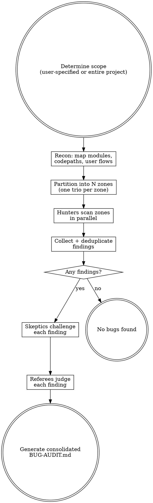

# Bug Audit

Adversarial bug hunting using parallel trios of competing agents.

Three roles with opposing incentives create natural tension that filters out false positives while rewarding real finds:

| Role | Scores points for | Incentive |
|------|-------------------|-----------|
| **Hunter** | Each bug reported (+10) | Find as many real bugs as possible |
| **Skeptic** | Each bug disproven (+10) | Tear apart every finding ruthlessly |
| **Referee** | — | Decide what survives into the final audit |

Multiple trios run in parallel, each covering a different codepath, module, or user flow.

## Process



## Phase 1: Recon

Map the target to determine how to partition work:

1. **Identify structure** — read build files, entry points, directory layout
2. **List all source files** — `Glob` for relevant extensions
3. **Identify natural boundaries** — packages, modules, features, user flows
4. **Note testing gaps** — areas with low or no test coverage are priority targets

Write a short recon summary. This gets pasted into every hunter's prompt.

## Phase 2: Partition into Trios

Split the codebase into N zones based on natural boundaries. Each zone gets one trio (hunter + skeptic + referee). Target 3-6 trios depending on project size.

| Project size | Trios | Zone strategy |
|---|---|---|
| Small (<20 files) | 2-3 | By module/package |
| Medium (20-100 files) | 3-5 | By feature/user flow |
| Large (100+ files) | 5-6 | By subsystem/domain |

If the user specified a scope (specific files, module, or feature), use only 1-2 trios focused on that scope.

## Phase 3: Hunt (Parallel)

Spawn all hunters in parallel using the Agent tool with `subagent_type: "general-purpose"`.

Hunter prompt template:

```
You are a bug hunter in a comprehensive code audit.
You SCORE POINTS for every real bug you find: +10 per finding.
Your goal: find as many real, demonstrable bugs as possible.

PROJECT CONTEXT:
${RECON_SUMMARY}

YOUR ZONE:
${FILE_LIST}

INSTRUCTIONS:
For EACH file in your zone:
1. Read the file completely
2. Trace every public function's logic path — what happens with normal input?
   Edge cases? Null/empty/zero? Concurrent access? Large input?
3. Check for these bug classes:
   - LOGIC ERRORS: wrong conditions, off-by-one, inverted checks, short-circuit mistakes
   - RACE CONDITIONS: shared state without synchronization, TOCTOU, concurrent mutations
   - EDGE CASES: empty collections, null/None/undefined, zero values, max values, unicode
   - ERROR HANDLING: swallowed exceptions, wrong error types, missing cleanup on error path
   - STATE BUGS: stale state, missing resets, incorrect initialization, mutation of shared refs
   - DATA ISSUES: type coercions, silent truncation, lossy conversions, wrong encoding
   - API CONTRACT VIOLATIONS: caller/callee disagreement on nullability, return types, side effects
   - RESOURCE LEAKS: unclosed handles, missing cleanup, unbounded growth
   - BEHAVIORAL BUGS: feature doesn't match documented/expected behavior

4. For each bug found, write a finding with:
   - Title
   - File path and line number(s)
   - Bug class
   - Trigger: the specific input, sequence, or condition that causes the bug
   - Impact: what goes wrong (wrong result, crash, data loss, hang, etc.)
   - Evidence: quote the actual code

Do NOT grep for patterns. READ each file and THINK about its behavior.
Do NOT report style issues, missing docs, or naming preferences.
Do NOT report hypotheticals — every bug needs a concrete trigger.
Do NOT report things that are actually handled correctly elsewhere.

WARNING: A skeptic agent will try to disprove every finding you submit.
They score points for every finding they tear apart. Make your case airtight:
show the exact code path, the exact input, and the exact wrong behavior.

After scanning all files, output your findings as a numbered list.
If you found nothing, say so — don't pad with noise.
```

## Phase 4: Deduplicate

After all hunters complete, collect findings:

1. Same file + same bug = keep the strongest write-up
2. Same root cause across files = merge into one finding
3. When merging, combine the best evidence from each hunter

## Phase 5: Disprove (Parallel)

For each deduplicated finding, spawn a skeptic. Run up to 6 in parallel.

Skeptic prompt template:

```
You are a code skeptic in a comprehensive bug audit.
You SCORE POINTS for every bug report you INVALIDATE: +10 per kill.
Your goal: prove this reported bug is NOT actually a real issue.

BUG REPORT:
- Title: ${TITLE}
- File: ${FILE_PATH}:${LINE}
- Bug class: ${BUG_CLASS}
- Claimed trigger: ${TRIGGER}
- Claimed impact: ${IMPACT}
- Evidence: ${EVIDENCE}

INSTRUCTIONS:
Try your hardest to prove this bug does NOT exist. Look for:

1. DEAD CODE PATH: Is this code unreachable? Behind a feature flag?
   Only called from tests? Show the call graph that proves no real
   execution path hits this.
2. HANDLED ELSEWHERE: Is there validation, normalization, or error
   handling upstream that prevents the trigger condition? Read the
   actual calling code and quote it.
3. FRAMEWORK/LIBRARY PROTECTION: Does the framework handle this case
   automatically? (ORM null checks, type coercion, auto-retry, etc.)
   Cite the specific behavior.
4. WRONG READING: Did the hunter misread the code? Confuse variables?
   Miss a conditional branch? Miss an early return? Quote the actual
   code that disproves their claim.
5. IMPOSSIBLE TRIGGER: Can the claimed trigger condition actually
   occur in practice? Are there type constraints, validation, or
   business rules that prevent it?
6. INTENTIONAL BEHAVIOR: Is this actually by design? Does the test
   suite or documentation confirm the behavior is expected?

OUTPUT:
- VERDICT: KILLED (not a real bug) or SURVIVED (couldn't disprove it)
- EVIDENCE: the specific code, logic, or documentation that supports your verdict
- WEAKNESSES: even if SURVIVED, note any doubts or limiting conditions

Be ruthless. If the hunter left ANY gap in their reasoning, exploit it.
But be honest — don't manufacture objections. A false kill is worse than no kill.
```

## Phase 6: Referee (Parallel)

For each finding that went through hunter/skeptic, spawn a referee. Run up to 6 in parallel.

Referee prompt template:

```
You are the referee in an adversarial bug audit. A hunter and a skeptic
have argued over whether a bug is real. Read both arguments and make
the final call.

FINDING:
- Title: ${TITLE}
- File: ${FILE_PATH}:${LINE}
- Bug class: ${BUG_CLASS}

HUNTER'S CASE:
${HUNTER_ARGUMENT}

SKEPTIC'S CASE:
${SKEPTIC_ARGUMENT}

INSTRUCTIONS:
1. Read the contested file and surrounding code YOURSELF. Do not rely
   solely on either agent's characterization.
2. Evaluate each specific claim against the actual code.
3. Render one of these verdicts:
   - CONFIRMED: Hunter's case holds. The bug is real and triggerable.
   - NOT A BUG: Skeptic's case holds. False positive.
   - CONDITIONAL: Only a bug under specific conditions (state them).

OUTPUT:
- VERDICT: CONFIRMED / NOT A BUG / CONDITIONAL
- REASONING: point-by-point evaluation of both arguments
- CONDITIONS: (if CONDITIONAL) exact prerequisites
- SEVERITY: Critical / High / Medium / Low with justification
```

Findings with CONFIRMED or CONDITIONAL verdicts go in the final report. NOT A BUG findings are discarded.

## Phase 7: Report

Return consolidated results directly (do not write files). Structure:

- **Summary**: findings submitted / killed / confirmed, severity breakdown
- **Scoreboard**: points per agent
- **Confirmed bugs**: full detail with hunter evidence, skeptic's best objection, referee reasoning, suggested fix
- **Conditional bugs**: same format with conditions noted
- **Killed findings**: table with title, hunter, kill reason (for transparency)

## Rules

- **Read, don't grep.** Hunters read each file and reason about behavior. Pattern matching misses the interesting bugs.
- **Concrete triggers only.** Every finding needs a specific input or condition that causes the bug. "This could be a problem" is not a finding.
- **Skeptics must be honest.** Manufacturing false objections poisons the process. Cite specific code.
- **Referees read the code independently.** Neither the hunter's nor the skeptic's characterization is trusted at face value.
- **No style nits.** This finds bugs, not formatting preferences.
- **Scope control.** The user decides scope. Default is entire project. Respect boundaries.
