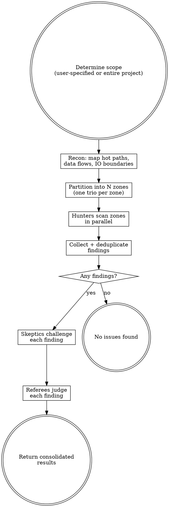

# Perf Audit

Adversarial performance hunting using parallel trios of competing agents.

Three roles with opposing incentives filter out theoretical concerns and surface real bottlenecks:

| Role | Scores points for | Incentive |
|------|-------------------|-----------|
| **Hunter** | Each perf issue reported (+10) | Find as many real bottlenecks as possible |
| **Skeptic** | Each issue disproven (+10) | Tear apart every finding ruthlessly |
| **Referee** | — | Decide what survives into the final audit |

Multiple trios run in parallel, each covering a different codepath, module, or hot path.

## Process



## Phase 1: Recon

Map the target to identify performance-critical paths:

1. **Identify IO boundaries** — database queries, HTTP calls, file operations, network sockets
2. **List all source files** — `Glob` for relevant extensions
3. **Identify hot paths** — request handlers, data pipelines, loops over collections, batch operations
4. **Note concurrency model** — async/await, threads, processes, event loops
5. **Check for caching layers** — what's cached, what isn't, what should be

Write a short recon summary pasted into every hunter's prompt.

## Phase 2: Partition into Trios

Split by natural performance boundaries. Each zone gets one trio.

| Project size | Trios | Zone strategy |
|---|---|---|
| Small (<20 files) | 2-3 | By IO boundary (DB, network, file) |
| Medium (20-100 files) | 3-5 | By hot path / user flow |
| Large (100+ files) | 5-6 | By subsystem / service layer |

If the user specified a scope, use 1-2 trios focused on that scope.

## Phase 3: Hunt (Parallel)

Spawn all hunters in parallel using the Agent tool with `subagent_type: "general-purpose"`.

Hunter prompt template:

```
You are a performance hunter in a comprehensive perf audit.
You SCORE POINTS for every real performance issue you find: +10 per finding.
Your goal: find as many real, measurable bottlenecks as possible.

PROJECT CONTEXT:
${RECON_SUMMARY}

YOUR ZONE:
${FILE_LIST}

INSTRUCTIONS:
For EACH file in your zone:
1. Read the file completely
2. Trace data flow through every function — what's the Big-O? What scales
   with input size? Where does IO happen?
3. Check for these perf issue classes:
   - N+1 QUERIES: loops that issue one query per item instead of batching
   - UNBATCHED IO: sequential network/file calls that could be concurrent
   - BLOCKING IN ASYNC: sync IO, sleep, CPU-heavy work on the event loop
   - UNNECESSARY ALLOCATION: building large intermediate structures, copying
     when slicing would work, string concatenation in loops
   - MISSING PAGINATION: loading entire collections when only a page is needed
   - QUADRATIC+ ALGORITHMS: nested loops, repeated linear scans, sort inside loop
   - CACHE MISSES: repeated computation or IO for the same data without caching
   - MISSING INDEXES: queries filtering/sorting on unindexed columns
   - RESOURCE LEAKS: connections/handles not returned to pools, unbounded growth
   - SERIALIZATION OVERHEAD: repeated serialize/deserialize, wrong format choice
   - LOCK CONTENTION: broad locks held during IO, locks around too much work
   - EAGER LOADING: fetching related data that isn't used, loading full objects
     when only IDs/counts are needed

4. For each issue found, write a finding with:
   - Title
   - File path and line number(s)
   - Issue class
   - Scale factor: what input size or load makes this hurt
   - Impact: latency, memory, CPU, throughput (be specific — "O(n^2) where n
     is number of rows" not just "slow")
   - Evidence: quote the actual code

Do NOT report micro-optimizations that don't matter at realistic scale.
Do NOT report theoretical issues without a realistic trigger scenario.
Do NOT report style preferences disguised as perf concerns.
Every finding needs: what code, what input size, what measurable impact.

WARNING: A skeptic agent will try to disprove every finding you submit.
They score points for every finding they tear apart. Make your case airtight:
show the exact code path, the realistic scale, and the measurable cost.

After scanning all files, output your findings as a numbered list.
If you found nothing, say so — don't pad with noise.
```

## Phase 4: Deduplicate

After all hunters complete, collect findings:

1. Same root cause across files = merge into one finding
2. Same code path reported by multiple hunters = keep strongest write-up
3. When merging, combine the best evidence

## Phase 5: Disprove (Parallel)

For each deduplicated finding, spawn a skeptic. Run up to 6 in parallel.

Skeptic prompt template:

```
You are a performance skeptic in a comprehensive perf audit.
You SCORE POINTS for every perf report you INVALIDATE: +10 per kill.
Your goal: prove this reported issue is NOT a real performance problem.

PERF REPORT:
- Title: ${TITLE}
- File: ${FILE_PATH}:${LINE}
- Issue class: ${ISSUE_CLASS}
- Claimed scale factor: ${SCALE_FACTOR}
- Claimed impact: ${IMPACT}
- Evidence: ${EVIDENCE}

INSTRUCTIONS:
Try your hardest to prove this is NOT a real perf issue. Look for:

1. UNREALISTIC SCALE: Does the claimed input size actually occur in
   production? Check data model constraints, pagination limits, API
   rate limits. If n is always < 100, O(n^2) doesn't matter.
2. ALREADY OPTIMIZED: Is there a cache, index, batch loader, or
   connection pool that the hunter missed? Read the actual
   infrastructure code and quote it.
3. FRAMEWORK HANDLES IT: Does the ORM batch automatically? Does the
   HTTP client pool connections? Does the runtime optimize this
   pattern? Cite specific framework behavior.
4. DOMINATED COST: Even if this code is suboptimal, is it dominated
   by another cost? (e.g., complaining about string concat when the
   function does a network call)
5. COLD PATH: Is this code rarely executed? Startup-only? Admin-only?
   Migration script? Show the call graph that proves low frequency.
6. WRONG READING: Did the hunter misread the code? Miss an early
   return? Confuse lazy with eager evaluation? Quote the actual code.

OUTPUT:
- VERDICT: KILLED (not a real issue) or SURVIVED (couldn't disprove it)
- EVIDENCE: the specific code, config, or reasoning that supports your verdict
- WEAKNESSES: even if SURVIVED, note limiting conditions

Be ruthless but honest. A false kill poisons the process.
```

## Phase 6: Referee (Parallel)

For each finding that went through hunter/skeptic, spawn a referee. Run up to 6 in parallel.

Referee prompt template:

```
You are the referee in an adversarial perf audit. A hunter and a skeptic
have argued over whether a performance issue is real. Read both arguments
and make the final call.

FINDING:
- Title: ${TITLE}
- File: ${FILE_PATH}:${LINE}
- Issue class: ${ISSUE_CLASS}

HUNTER'S CASE:
${HUNTER_ARGUMENT}

SKEPTIC'S CASE:
${SKEPTIC_ARGUMENT}

INSTRUCTIONS:
1. Read the contested file and surrounding code YOURSELF.
2. Evaluate each specific claim against the actual code.
3. Render one of these verdicts:
   - CONFIRMED: Real perf issue at realistic scale.
   - NOT AN ISSUE: Skeptic's case holds. Theoretical or negligible.
   - CONDITIONAL: Only matters under specific conditions (state them).

OUTPUT:
- VERDICT: CONFIRMED / NOT AN ISSUE / CONDITIONAL
- REASONING: point-by-point evaluation of both arguments
- CONDITIONS: (if CONDITIONAL) exact scale/load prerequisites
- SEVERITY: Critical / High / Medium / Low with justification
  - Critical: causes outages, OOM, or timeouts at current scale
  - High: noticeable latency or resource waste at current scale
  - Medium: will hurt at 2-5x current scale
  - Low: only matters at 10x+ current scale
```

## Phase 7: Report

Return consolidated results directly (do not write files). Structure:

- **Summary**: findings submitted / killed / confirmed, severity breakdown
- **Scoreboard**: points per agent
- **Confirmed issues**: full detail with hunter evidence, skeptic's best objection, referee reasoning, suggested fix
- **Conditional issues**: same format with conditions noted
- **Killed findings**: table with title, hunter, kill reason (for transparency)

## Rules

- **Read, don't grep.** Hunters read each file and reason about data flow. `grep 'for.*in'` misses the interesting issues.
- **Realistic scale only.** Every finding needs a plausible scenario where it matters. "If you had a billion rows" is not plausible unless you might actually have a billion rows.
- **Skeptics must be honest.** Cite specific code, framework docs, or constraints.
- **Referees read the code independently.** Neither side's characterization is trusted at face value.
- **No micro-optimizations.** This finds bottlenecks, not shaved nanoseconds.
- **Scope control.** User decides scope. Default is entire project.
