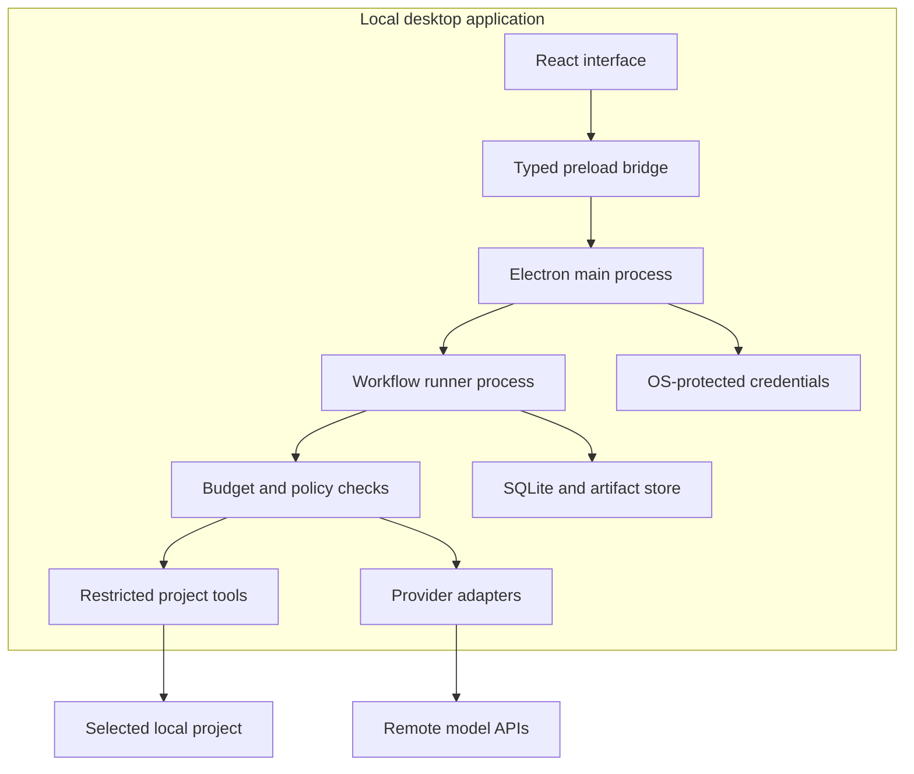
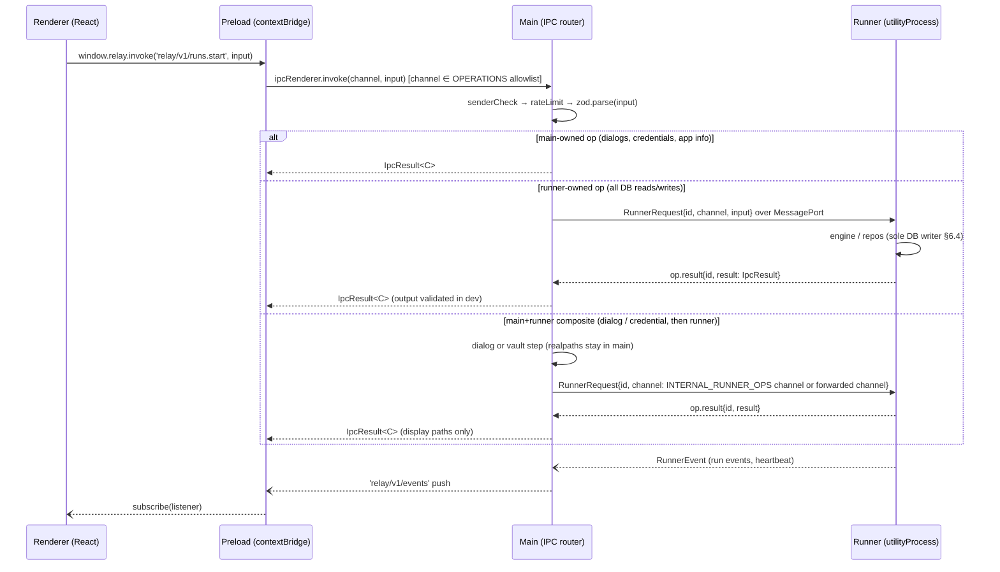
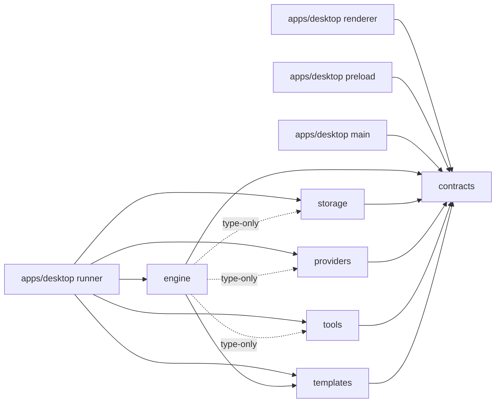

# Architecture overview

Source: spec §6 ([`Relay_Product_and_Engineering_Plan.md`](../../Relay_Product_and_Engineering_Plan.md)) and [plans/02 §B0](../../plans/02-contracts-api-layer.md). The IPC reference is generated into [`ipc-api.md`](ipc-api.md) by `pnpm gen:api-doc`; do not hand-edit it.

## System diagram (spec §6.2)

**Boundary:** Local project context leaves the machine only through configured provider calls in P0. No Relay-hosted backend is required. Local persistence does not make remote inference private or offline. The provider selection determines where selected context is processed.

## Processes and IPC (plans/02 §B0)

Relay has no HTTP server in P0 (ADR-0009). Its API is a typed, versioned IPC surface with two hops (renderer → main, main → runner). Channels are named `relay/v1/<resource>.<verb>` and return an `IpcResult` envelope (ADR-0018). The runner, a `utilityProcess`, is the sole database writer (spec §6.4).

## Package dependency direction (spec §13.4)

Enforced by `pnpm lint`:

- ESLint `boundaries/dependencies` restricts which element may import which (the edges above; main, preload, and renderer import only `@relay/contracts`).
- The engine may import storage, providers, and tools **only as types**; implementations are injected. Engine tests, `src/testing/**`, and the Electron-free composition root `src/runtime.ts` are the exceptions (R2-2).
- The renderer never imports Node, Electron, or provider SDKs. `node:sqlite` appears only in `@relay/storage`; `electron` never appears in `packages/*`; provider SDKs appear only in `@relay/providers` (dependency-cruiser).
- Deep imports into another package's `src/` or `dist/` are errors; import the package's public API.
