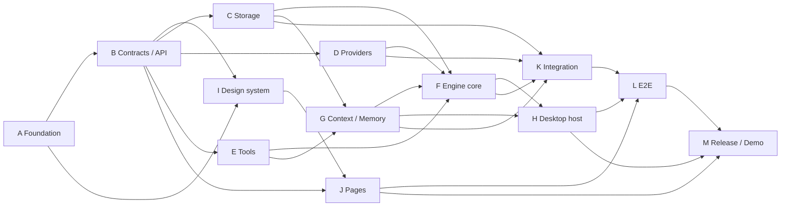

# Relay P0 Prototype — Implementation Plan (Master)

> Source of truth: [`Relay_Product_and_Engineering_Plan.md`](../Relay_Product_and_Engineering_Plan.md) (the "spec"). Every section reference `§N.N` points into that document.
> This plan turns the spec into numbered, agent-executable work packages with **exclusive file ownership**, **command-based gates**, and a built-in **adversarial audit loop** (see [14-review-harness.md](14-review-harness.md)).
> Written: 2026-09-30 (start of spec milestone M1). Pitch: 2026-11-11.

## 0. How to read this plan

| File | What it is | Owner |
|---|---|---|
| `00-overview.md` | This file: agents, phases, dependency graph, verification, decisions | Orchestrator |
| [`00b-engineering-standards.md`](00b-engineering-standards.md) | Coding standards every agent follows (TypeScript, React, SQL, tests, security) | All agents (read-only) |
| [`01-foundation.md`](01-foundation.md) | Monorepo, tooling, lint boundaries, CI | Agent A |
| [`02-contracts-api-layer.md`](02-contracts-api-layer.md) | **API layer**: domain types, Zod schemas, IPC operation catalog, runner protocol, error taxonomy | Agent B |
| [`03-storage-db-layer.md`](03-storage-db-layer.md) | **DB layer**: SQLite schema DDL, migrations, driver, repositories, unit of work, backup | Agent C |
| [`04-providers.md`](04-providers.md) | Provider adapters (Anthropic, OpenAI, Fake), capability + price catalog | Agent D |
| [`05-tools-fs-artifacts.md`](05-tools-fs-artifacts.md) | Root-confined file access, exclusions, diff intake, artifact store | Agent E |
| [`06-engine-core.md`](06-engine-core.md) | **Backend core**: run/step state machines, checkpoint protocol, budget ledger, policy, retry, recovery | Agent F |
| [`07-engine-context-memory-templates.md`](07-engine-context-memory-templates.md) | Context assembly, memory service, review-propose-fix template + output schemas | Agent G |
| [`08-desktop-host.md`](08-desktop-host.md) | Electron main, preload bridge, IPC router, credentials vault, runner supervisor, runner entry | Agent H |
| [`09-design-system.md`](09-design-system.md) | Tokens, Tailwind theme, accessible component library | Agent I |
| [`10-renderer-pages.md`](10-renderer-pages.md) | Pages, routing, data layer (TanStack Query), fake bridge | Agent J |
| [`11-integration-tests.md`](11-integration-tests.md) | Cross-package integration + crash-recovery harness + fixtures | Agent K |
| [`12-e2e-playwright.md`](12-e2e-playwright.md) | Playwright-Electron E2E suite, page objects, a11y scans | Agent L |
| [`13-release-demo-eval.md`](13-release-demo-eval.md) | Packaging, demo reset, secret scan, evaluation harness, pitch docs | Agent M |
| [`14-review-harness.md`](14-review-harness.md) | Gates, Bug Hunter / Defender / Referee audit, security checklist, review-round log | Orchestrator |
| [`mocks/index.html`](mocks/index.html) | Clickable HTML mocks of every P0 screen and state | Reference for I, J, L |

**Unit tests are owned by the agent that owns the source file** and live beside it (`foo.ts` → `foo.test.ts`). Plans 11 and 12 own only cross-package suites.

## 1. Stack decisions (verified 2026-09-30)

Version facts were checked against npm/official docs on 2026-09-30. Pin exact versions in `pnpm-lock.yaml` at bootstrap; the numbers below are the *starting* targets, not a substitute for the lockfile (§13.5).

| Concern | Decision | Version target | Why / spec link |
|---|---|---|---|
| Language | TypeScript `strict` everywhere | TS 5.9+ | §6.1 |
| Package manager | pnpm workspaces | pnpm 10 | §13.1 |
| Desktop host | Electron | 44.x (Node 24.21, Chromium 152) | §6.1 |
| Runner process | `utilityProcess.fork` + `MessageChannelMain` | Electron API | §6.1 "separate runner process"; recommended over `child_process` |
| Build | **electron-vite** (main / preload / renderer / runner entries) | electron-vite 5, Vite 7 (peer range stops at 7) | Forge's Vite plugin is still *experimental*; electron-vite supports `?modulePath` utility entries first-class. **Deviation from §13.1 `forge.config.ts`** → ADR-011 |
| Packaging | electron-builder | 26.x | ADR-011 |
| Database | **`node:sqlite` `DatabaseSync`** behind a `SqlDriver` interface | Node 24 built-in (Stability 1.2 RC) | No native module → no ABI rebuild, no ASAR unpack, same code in Vitest and Electron. `backup()` built in. Fallback: `better-sqlite3` v13 (N-API) behind the same interface → ADR-012 |
| Validation | Zod | 4.x (`z.toJSONSchema()` built in) | §12.5 "runtime schemas validate all IPC" |
| UI | React 19 + React Router 8 (`createHashRouter`) + TanStack Query 5 | — | Hash routing works under `file://` |
| Styling | Tailwind CSS 4 (`@tailwindcss/vite`) + CSS variable tokens + Radix primitives + lucide-react | — | [09-design-system.md](09-design-system.md) |
| Fonts | `@fontsource/fira-sans`, `@fontsource/fira-code` (bundled, no network) | — | ui-ux-pro-max recommendation for technical dashboards |
| Provider A | Anthropic Messages API via `@anthropic-ai/sdk` | 0.129+ | §8; default model `claude-opus-5-5` |
| Provider B | OpenAI Responses API via `openai` | 7.25+ | §8; model id chosen at implementation, verified (§8.1) |
| Provider C | Google Gemini via `@google/genai` | latest at D10 | Founder request 2026-09-30. Same adapter contract, after A+B pass |
| Unit/integration tests | Vitest | 5.x | §17.2 |
| E2E | Playwright `_electron.launch()` (experimental API, Electron v14+) | 1.63+ | §17.2 |
| Lint | ESLint 10 flat config + `eslint-plugin-boundaries` + `dependency-cruiser` 18 in CI | — | §13.4 dependency direction |
| Target OS for pitch | **macOS (Apple silicon)** | — | §24.2 open question; assumed. Change in [13](13-release-demo-eval.md) if different |

## 2. Agent teams and exclusive file ownership

"Files owned" uses globs; **no glob overlaps another agent's**. Shared config files at the root are owned by Agent A, and other agents request changes through the orchestrator. They do not edit those files.

| Agent | Plan | Files owned (exclusive) | Depends on |
|---|---|---|---|
| **A: Foundation** | 01 | `package.json`, `pnpm-workspace.yaml`, `tsconfig.base.json`, `tsconfig.json`, `tsconfig.tools.json` (covers `playwright.config.ts`), `scripts/tsconfig.json`, `eslint.config.js`, `.dependency-cruiser.cjs`, `vitest.config.ts` (Vitest 5 `test.projects`), `.gitignore`, `.editorconfig`, `.prettierrc.json`, `.nvmrc`, `.npmrc`, `.env.example`, `README.md`, `.github/workflows/ci.yml`, `docs/adr/*.md`, `docs/architecture/*.md`, `packages/*/package.json`, `packages/*/tsconfig.json`, `apps/desktop/package.json`, `apps/desktop/tsconfig*.json`, `tests/package.json`, `tests/tsconfig.json`. Creates the `tests/helpers/no-network.ts` placeholder **once**, and K owns it afterwards. Creates `scripts/_placeholder.ts` (`export {};`) **once**; M owns it afterwards and deletes it when the first real script lands | — |
| **B: Contracts / API layer** | 02 | `packages/contracts/src/**` (including the step **output schemas** `src/outputs/*.v1.ts`, the context manifest schema, and `BudgetBreakdown`, so the renderer can import them) | A |
| **C: Storage / DB layer** | 03 | `packages/storage/src/**`, `packages/storage/migrations/**` | A, B |
| **D: Providers** | 04 | `packages/providers/src/**` (including `src/fake-fixtures/**` and `src/__fixtures__/**` SSE streams), `packages/providers/catalog/**`, `tests/live/**` | A, B, K1 (sample-api content that fake patches apply to) |
| **E: Tools / FS / Artifacts** | 05 | `packages/tools/src/**` | A, B |
| **F: Engine core** | 06 | `packages/engine/src/{index,runner,run-machine,step-machine,checkpoints,budget,policy,retry,recovery,cancellation,deadline,revision,approvals,services,ports,clock,seed,runtime,report,setup-calls,profiles}.ts`, `packages/engine/src/steps/**`, `packages/engine/src/testing/**` | B, C, D, E (interfaces), G (context/memory interfaces) |
| **G: Context / Memory / Templates** | 07 | `packages/engine/src/{context,prompt-render,memory,memory-retrieval,token-budget,manifest}.ts`, `packages/templates/{src,review-propose-fix}/**` | B, C, E |
| **H: Desktop host** | 08 | `apps/desktop/src/main/**`, `apps/desktop/src/preload/**`, `apps/desktop/src/runner/**`, `apps/desktop/electron.vite.config.ts`, `apps/desktop/vite.renderer.config.ts`, `apps/desktop/build/**` (CSP plugin), `apps/desktop/electron-builder.yml`, `apps/desktop/resources/**` | B, F (`createRuntime`) |
| **I: Design system** | 09 | `apps/desktop/src/renderer/styles/**`, `apps/desktop/src/renderer/components/ui/**`, `apps/desktop/src/renderer/lib/format/**` | A, B (status enums) |
| **J: Renderer pages** | 10 | `apps/desktop/src/renderer/{index.html,main.tsx,App.tsx,router.tsx,test-setup.ts,index-html.test.ts}`, `apps/desktop/src/renderer/{api,pages,features,hooks,state}/**` | B, I |
| **K: Integration tests** | 11 | `tests/integration/**`, `tests/fixtures/**`, `tests/helpers/**` (including `make-fixture-db.ts`) | K1–K2: B only. K3+: C, D, E, F, G |
| **L: E2E** | 12 | `tests/e2e/**`, `playwright.config.ts` | H, J, K1 |
| **M: Release / Demo / Eval** | 13 | `scripts/**` (except `scripts/tsconfig.json`), `tests/evaluations/**`, `docs/demo/**`, `docs/product/**`, `docs/release/**` | H, J, K |

Ownership conflicts to watch:

- `packages/engine/src/` is split by **file name** between F and G. `index.ts` (the barrel) belongs to F. G's modules are exported through F's barrel, and F adds those export lines in task **F1**.
- `packages/templates/package.json` and `tsconfig.json` belong to A. G owns only `src/**` and `review-propose-fix/**`.
- Provider output fixtures used by the fake adapter are D-owned (`packages/providers/src/fake-fixtures/`) and are **statically imported**, so no package reads `tests/**` at runtime. K's `tests/fixtures/provider-responses/` holds only integration-specific variants.
- `apps/desktop/src/renderer/` is split by directory between I (styles, ui, format) and J (everything else).
- Root `package.json` scripts belong to A. If another agent needs a new script, it asks the orchestrator, who applies it as an A-follow-up commit.

## 3. Execution waves (milestone-driven)

Agents own layers, but the spec's milestones are **vertical slices** (§15.2). Execution therefore proceeds in **waves**. Each wave takes the *subset of tasks* from several plans that its milestone gate needs. A plan is marked done only after its last wave.

```
Wave 0 (M1 start)   A all  →  B all  ║  K1–K2 fixtures  ║  I1–I4
Wave 1 (M1 finish)  C1–C6 ║ D1–D4, D7–D8 ║ E1–E4, E6 ║ G6 (template + prompts)
                    → F1–F5, F13 (minimal loop: intake, one model step, finalize), F15, F16 (runtime/seed)
                    → H1–H7 ║ J1–J4 (on fake bridge, then real bridge)  → L1–L3 + @m1 specs
Wave 2 (M2)         D5–D6, D9 ║ D10 Gemini (after D5 passes; first cut if behind) ║ E5, E7 ║ F6–F8, F10 (approval), F14, F18 ║ J6–J8 (onboarding, new run, inspector core)
                    → K5 (@m2 subset) ║ live workflow smoke (D9b)
Wave 3 (M3)         G1–G5 ║ F9, F11 ║ J9 (memory) ║ K4 crash matrix, K5/K6 @m3  ║ L @m3 specs
Wave 4 (M4)         F5 overrun/setup, F12, report (F17) ║ J8 complete, J10 ║ K remaining ║ L @m4 specs
Wave 5 (M5)         H9 packaging ║ L all + @a11y ║ M1–M4
Wave 6 (M6)         M5–M6, freeze; final verification (§6) + whole-repo audit
```

Rules:
- Within a wave, `║` means parallel and `→` means "after".
- A task's dependencies must be done, **or an earlier wave must have landed the port or interface it needs**. For example, F starts against `ports.ts` before G1–G5 exist. The Wave 1 minimal context assembler is a G-owned stub: `context.ts` with steps 1, 2, 4, 6, and 8 only, plus the minimal `prompt-render.ts` pieces and `manifest.ts`. G completes it in Wave 3 (07 "Delivery phasing").

### Dependency graph



Precise blocking edges:

| Edge | What exactly blocks |
|---|---|
| B → everyone | `@relay/contracts` exports: IDs, `Microusd`, status enums, `AppError`/`ErrorCode`, IPC operation catalog, runner protocol, workflow spec schema |
| C → F, G | `Db`/`UnitOfWork` interface, repositories, migration `0001` applied in tests via `openTestDb()` |
| D → F | `ProviderAdapter` interface + `FakeProvider` (F's tests run only on Fake) |
| E → F, G | `ProjectFs` (`readSelected`, `hashFile`), `ArtifactStore` |
| G → F | `ContextAssembler.assemble()` and `MemoryService.snapshotForRun()` signatures. F can start against the **ports** in `packages/engine/src/ports.ts` (F-owned) before G lands. |
| F, G → H | `createEngine(deps)` factory + `EngineApi` command surface |
| B, I → J | J builds against `fake-bridge.ts`, so it does not wait for H |
| F16 → H, K, M | `createRuntime()` (Electron-free composition) is imported by the H runner entry, the K crash harness, and the M evaluation/demo scripts |
| K1 → D, G, L | `sample-api` content is needed by D fake patch fixtures, G hostile-prompt tests, and L project copies |
| H, J → L | A launchable app with `RELAY_PROVIDER_MODE=fake` |

## 4. Mapping to spec milestones (§15.2)

Agents build horizontally, but each milestone's exit gate from the spec must still be demonstrable at the date shown. The orchestrator therefore runs a **vertical-slice check** at each milestone boundary:

| Spec milestone | Dates | Plans that must be *done* | Vertical-slice check (exact) |
|---|---|---|---|
| M1 Desktop vertical slice | Sep 30–Oct 6 | Wave 0–1: 01, 02, 03 (C1–C6), 04 (D1–D4, D7–D8), 05 (E1–E4, E6), 06 (F1–F5, F13 minimal, F15, F16), 07 (G6 + stub context), 08 (H1–H7), 09 (I1–I4), 10 (J1–J4), 11 (K1–K2), 12 (L1–L3 + @m1 specs) | `pnpm e2e --grep @m1`: app opens, project selected, one fake single-step request runs with reserve/settle recorded (§15.4 "simple instrumentation"), run visible after relaunch |
| M2 Workflow + portability | Oct 7–13 | Wave 2: 04 complete, 05 complete, 06 (F6–F8, F10, F14, F18), 10 (J6–J8 core) | `pnpm test:integration -t "@m2"` + `RELAY_LIVE_TESTS=1 pnpm test:live` **including `workflow.live.test.ts`**: the same template completes through **each** adapter (§15.2 M2 gate) under `RELAY_LIVE_WORKFLOW_CAP_MICROUSD` (default $1.50) |
| M3 Memory + recovery | Oct 14–20 | 06 (F9 recovery, F11), 07 complete, 11 (K3–K6) | `pnpm test:integration -t "@m3"`: crash matrix green; project isolation green |
| M4 Limits + evidence | Oct 21–27 | 06 complete, 10 complete, 11 complete | `pnpm e2e --grep "@m4"` (budget pause, cancel, export) |
| M5 Pilot + hardening | Oct 28–Nov 3 | 12 complete, 13 (M1–M4) | Full §6 verification on the demo Mac; packaged app launches |
| M6 Freeze + pitch | Nov 4–10 | 13 complete | `pnpm demo:reset && pnpm demo:verify`; rehearsal checklist in `docs/demo/` |

**Scope-cut order** if behind. The first set is spec §21.1 verbatim: visual canvas (not planned), arbitrary workflow structure (already disabled), schedules (not planned), providers beyond two, second-OS packaging, embeddings, automatic model routing, and shell execution (none planned). After that, these plan-level cuts apply in order:
1. Light theme polish.
2. OpenAI reconciliation via `responses.retrieve` (fall back to the unknown-outcome decision flow).
3. Memory conflict *resolution* UI. **This is a deviation:** it keeps detection and a blocking warning, so §5.5 "do not silently combine" still holds.
4. Patch generation, which leaves the review-and-plan workflow of §21.1 paragraph 2. **Never cut:** ledger admission, checkpoints, approval binding, memory approval, path confinement, credential protection.

## 5. Repository layout after all plans complete

```
relay/
├── Relay_Product_and_Engineering_Plan.md        # spec (unchanged)
├── plans/                                       # this plan
├── package.json  pnpm-workspace.yaml  tsconfig.base.json  eslint.config.js
├── .dependency-cruiser.cjs  vitest.config.ts  playwright.config.ts
├── .github/workflows/ci.yml
├── apps/desktop/
│   ├── electron.vite.config.ts  electron-builder.yml  package.json
│   ├── resources/ (icon, entitlements)
│   └── src/
│       ├── main/        index.ts ipc/ credentials.ts runner-supervisor.ts dialogs.ts security.ts logging.ts app-paths.ts
│       ├── preload/     index.ts
│       ├── runner/      runner.ts protocol-server.ts compose.ts (wraps @relay/engine createRuntime)
│       └── renderer/    index.html main.tsx App.tsx router.tsx
│                        api/ pages/ features/ hooks/ state/ components/ui/ styles/ lib/format/
├── packages/
│   ├── contracts/src/   ids.ts money.ts time.ts errors.ts status.ts domain/*.ts workflow-spec.ts ipc/*.ts runner-protocol.ts events.ts redaction.ts index.ts
│   ├── storage/         src/{driver,db,unit-of-work,migrate,backup}.ts src/repos/*.ts migrations/*.ts (embedded SQL)
│   ├── providers/       src/{types,anthropic,openai,fake,catalog,pricing,usage,errors,estimate,tracked-fetch}.ts src/fake-fixtures/ src/__fixtures__/ catalog/*.json
│   ├── tools/           src/{paths,exclusions,scan,read,diff-intake,artifact-store,export,hash}.ts
│   ├── engine/          src/*.ts src/steps/*.ts src/testing/*.ts
│   └── templates/       review-propose-fix/{workflow.json,prompts/*.ts} src/{index,strict-json-schema}.ts  (output schemas live in contracts/src/outputs)
├── tests/
│   ├── fixtures/        sample-api/ provider-responses/ (integration variants) databases/
│   ├── helpers/         crash-harness.ts runner-child.ts engine-harness.ts temp-dirs.ts make-fixture-db.ts no-network.ts
│   ├── live/            *.live.test.ts (D-owned)
│   ├── integration/     *.int.test.ts
│   ├── e2e/             fixtures.ts pages/*.ts specs/*.spec.ts
│   └── evaluations/     tasks/*.json rubric.md
├── scripts/             demo-reset.ts demo-verify.ts demo-snapshot.ts check-no-secrets.ts check-project-untouched.ts
│                        evaluate.ts evidence-table.ts verify-package.ts
└── docs/                adr/ architecture/ product/ demo/ release/
```

## 6. Verification (final, and after every plan)

Every plan's gate includes the **always-on core gate**:

```bash
pnpm install --frozen-lockfile
pnpm typecheck        # tsc -b across all projects → exit 0
pnpm lint             # eslint + dependency-cruiser → exit 0, 0 warnings (--max-warnings 0)
pnpm test:unit        # vitest --project unit → all green
```

Final integration verification (Phase 6), in order, all must exit 0:

```bash
pnpm install --frozen-lockfile
pnpm typecheck
pnpm lint
pnpm test:unit --coverage              # thresholds: contracts 95%, engine 90%, storage 90%, providers 85%, tools 90% lines
pnpm test:integration                     # includes crash matrix (11 §K4)
pnpm build                                # electron-vite build → apps/desktop/out/{main,preload,renderer,runner}
RELAY_E2E_KEEP=1 pnpm e2e                 # Playwright, fake provider, all specs incl. @a11y; keeps the userData dir for the scan
pnpm check:secrets                        # scripts/check-no-secrets.ts over a post-e2e userData dir → "0 findings"
pnpm check:project-untouched              # sample-api fixture tree hash identical before/after e2e
RELAY_LIVE_TESTS=1 pnpm test:live         # manual, capped at $0.10 connection smokes + $1.50 workflow smoke (D9b), before milestone sign-off only
pnpm package                              # electron-builder --mac dir → launches via scripts/verify-package.ts
```

Expected domain outcomes (checked by the suites above; listed here so reviewers can trace them to spec):

| Spec requirement | Proven by |
|---|---|
| FR-01 project + file preview | e2e `onboarding.spec.ts` |
| FR-02 two providers, redacted status | e2e `provider-settings.spec.ts`, live smoke |
| FR-03 profiles snapshotted | int `run-snapshot.int.test.ts` |
| FR-04 full template | e2e `run-happy-path.spec.ts` |
| FR-05 bounded execution | int `budget-admission.int.test.ts`, `limits.int.test.ts`; e2e `budget-pause.spec.ts` |
| FR-06 memory persists + scoped | int `memory-isolation.int.test.ts`; e2e `memory.spec.ts` |
| FR-07 checkpoints | int `crash-matrix.int.test.ts`; e2e `restart-recovery.spec.ts` |
| FR-08 bound approval | int `approval-binding.int.test.ts`; e2e `approval-stale.spec.ts` |
| FR-09 usage certainty | unit `budget.test.ts` + `ledger-repo.test.ts`; e2e `run-happy-path` ledger assertions (Reserved > 0 while running; est. label after `accept_estimated_charge`) |
| FR-10 export without source writes | e2e `run-happy-path` + `check:project-untouched` |
| FR-11 stop/cancel | int `cancellation.int.test.ts`; e2e `cancel.spec.ts` |
| FR-12 recoverable failures | int `failure-modes.int.test.ts` |
| FR-12 recoverable pauses (`output_invalid`, `provider_unavailable`, `rate_limited`, `model_refused`, `unknown_outcome` → run `paused`, never `failed`; resumed via retry step / choose profile / decide unknown) | int `failure-modes.int.test.ts` (`#malformed`, `#transport`, `#rate-limit`, `#refused`, `#midstream`) |
| FR-12 pause states in the UI (`paused(output_invalid)` → Retry step, `paused(budget_overrun)` → Acknowledge overrun, `paused(limit_attempts)` → Raise limits) | e2e `pause-states.spec.ts` |
| §3.3 no plaintext keys | `check:secrets`, unit `redaction.test.ts`, e2e `provider-settings.spec.ts` |
| §3.3 keyboard + text status | e2e `a11y.spec.ts` (axe + keyboard walk) |
| §3.3 UI responsive during calls; < 1 s navigation; latency shown separately | e2e `responsiveness.spec.ts`, `run-happy-path` Attempts tab |
| §18.4 project export | int `project-export.int.test.ts` |

## 7. Decisions recorded as ADRs (Agent A writes, A1 task)

ADRs 001–010 are copied from spec §24.1. New ADRs:

| ADR | Decision | Reason |
|---|---|---|
| 011 | electron-vite + electron-builder instead of Forge | Forge Vite plugin is experimental; utility-process entry support |
| 012 | `node:sqlite` behind `SqlDriver`; better-sqlite3 v13 as fallback | No native rebuild; same binary in tests and app |
| 013 | Engine owns **all** retries; provider SDK `maxRetries: 0` | Each HTTP attempt must be an `Attempt` row with its own reservation (§7.3, §9.3) |
| 014 | No model tool-use in P0; context is assembled by the application up front | Keeps the permission surface to typed application reads (§11.1, §11.4); tool-call limit stays enforced for the future |
| 015 | Diff input = selected files or an imported `.diff/.patch` file; no `git` subprocess in P0 | "Run arbitrary shell commands: Denied in P0" (§11.1). isomorphic-git is a P1 option |
| 016 | Anthropic refusal-fallback (`fallbacks`) **off** by default; opt-in per profile and recorded in the snapshot | The adapter must not silently switch models (§6.3, §8.4), and a fallback model has a different price (§9.2) |
| 017 | All money is integer micro-USD; ledger balances derived only from immutable signed bucket entries | §9.2, §9.3 |
| 018 | IPC is resource-namespaced, versioned (`relay/v1/...`), returns a `Result` envelope | [02-contracts-api-layer.md](02-contracts-api-layer.md) |

## 8. Open questions (non-blocking; defaults chosen)

| Question (spec §24.2) | Default taken in this plan | Where to change |
|---|---|---|
| Which OS for pitch? | **Confirmed 2026-09-30:** macOS 26 on Apple silicon (arm64), Node 24.18 | 13 §M1 |
| Which providers? | **Confirmed 2026-09-30:** Anthropic + OpenAI (P0 pair for the M2 gate) **+ Gemini** as a third adapter (04 §D10, Wave 2 tail). Gemini is the first scope cut if behind (§21.1 "providers beyond two") | 04 |
| OpenAI model id / prices | Filled in at D6 from the official pricing page, with `source` + date; **never invented** | `packages/providers/catalog/` |
| Founder spending cap | **Founder self-funds** (confirmed). Default dev cap $50 until the founder sets a number. Live smokes capped at $0.10, workflow smoke $1.50 | 04 D9, `.env.example` |
| Customer model | **Confirmed:** other companies will use Relay with **their own keys** (BYOK). This matches the P0 design (§20.3). Team/org features stay P2 (§3.1) | 02, 08 |
| M0 discovery | **Not started** as of 2026-09-30. Implementation proceeds in parallel. Interviews are tracked in `docs/product/m0-status.md` and reviewed at every milestone gate (§20.1 pivot trigger) | 13 §M5 |
| Fixture repository | Founder-owned `tests/fixtures/sample-api` (≈15 TS files, 3 seeded defects) | 11 K1 |

## 9. Status tracker (the orchestrator updates this table)

**M1 reached 2026-09-30.** **M2–M5 functionally complete 2026-10-01** (fake providers). Final sweep 2026-10-01: typecheck, lint (eslint + depcruise), 2,675 unit (coverage thresholds met), 81 integration (crash matrix included), build, e2e 36/36 (M1–M4 + a11y), `pnpm package` + verify-package 19/19, check:secrets 0 findings, check:project-untouched OK, demo reset+verify ×2, evaluate --dry-run ($0). **Sign-off pending:** live three-provider run (D9b, ~$1.50 cap) — needs founder approval + API keys.

| Plan | Status | Audit | Open items |
|---|---|---|---|
| 01 Foundation | done | fixed F1–F7 | |
| 02 Contracts / API | done | fixed B1–B16 | |
| 03 Storage | done | fixed B1–B5, txResult, deferred_pause; verification gaps closed | |
| 04 Providers | done (Anthropic, OpenAI, Gemini, fake, live tests) | fixed (Anthropic F1–F6, OpenAI B1–B9, Gemini G1–G4) | Anthropic prices pending official-page verification; live run never executed |
| 05 Tools | done | fixed B1–B12, S1 (credential-file exclusions) | content-based secret scan of intake files (founder decision) |
| 06 Engine | done | fixed B1–B9, BH-1..8, money audit 1–4, verification 1–8 (readiness checks, report regeneration, daily sweep) | setup unknown liability has no resolve path (founder decision) |
| 07 Context/Memory/Templates | done | fixed BH-1..8 | |
| 08 Desktop host | done (H1–H10) | security audit clean; hardening/preload/handler/logger tests added | hardenedRuntime off until a Developer ID exists (accepted risk); GrantFileProtocolExtraPrivileges stays on (file:// renderer) |
| 09 Design system | done | fixed B1–B13 | ConflictCompare slots, ConfirmDialog secondary action, date input |
| 10 Renderer | done (J1–J10) | fixed J9/J10 B1–B14; dead stub UI removed | `editable.limits` always true: by design (§5.3; `P0_EDITABLE` in engine `workflows.ts`, enforced by `applyDraftPatch`); full third-party license list not bundled |
| 11 Integration | done (27 suites) | – | |
| 12 E2E | done (36) | – | |
| 13 Release/Demo/Eval | done (M1–M5) | packaging fix (no node_modules in asar); demo scratch-dir guard fix | founder: spending cap, baseline choice, demo launch mode, live-labelled prepared runs |

Incident log: 2026-09-30 18:27 a test helper recursively deleted the contents of the user's `$TMPDIR` (path computed one level too high). Fixed with ownership-guarded delete helpers in tests/helpers and tests/e2e; recorded as a standing rule.
