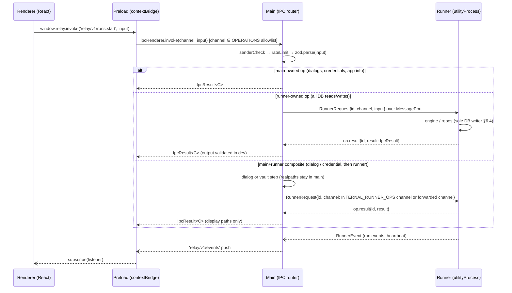

# Plan 02: Contracts & API Layer (Agent B)

Spec: §6.3, §6.4, §7.7, §8.3, §9.2, §10.2, §12.2, §12.4, §12.5, §12.6 · Backlog: RLY-004, RLY-012 (output schemas) · Wave (00 §3): **Wave 0 / M1** B all (after A)

Files (exclusive): `packages/contracts/src/**`

`@relay/contracts` is the **only** package every layer may import (§13.4). It has **zero** runtime dependencies besides `zod`. It contains no Node or Electron APIs and no I/O.

Besides the IPC surface, contracts owns every shape that crosses a package boundary: primitives and enums, domain DTOs and views, the **step output schemas** (`findings.v1`, `plan.v1`, `patch.v1`, `review.v1`, `report.v1`), the **context manifest** schema, the model catalog/capability/price schemas, and the ledger balance/breakdown schemas. Templates (07) re-export the output schemas and add the strict JSON-schema conversion. Engine, providers, storage, desktop, and renderer import these types from here and never redefine them.

---

## B0. API layer architecture

Relay has no HTTP server in P0 (§6.2, ADR-009). Its "API" is a **typed, versioned IPC surface** with two hops, and a separate internal protocol behind it:



Design rules (adapted from the `api-design` skill, which is REST-oriented; each REST concept maps to an IPC equivalent):

| REST concept (api-design skill) | Relay IPC equivalent |
|---|---|
| Resource URLs, plural nouns | Channel `relay/v1/<resource>.<verb>`. Resources are plural: `projects`, `runs`, `memory`, `artifacts`, `providers`, `profiles`, `workflows`, `approvals`, `ledger`, `app` |
| HTTP methods | Verb suffix. Queries: `list`, `get`, `preview`. Commands: `create`, `update`, `delete`, `archive`, plus domain actions (`start`, `pause`, `resume`, `cancel`, `decide`, `approve`, `export`). Queries are side-effect-free and safe to retry |
| Status codes | `IpcResult` envelope `{ ok: false, error: { code } }`. The stable `ErrorCode` taxonomy (§12.6) replaces HTTP codes. A table in B3 maps each code to an HTTP code for the future headless API |
| Response envelope | `IpcResult<C> = { ok: true, data, meta? } \| { ok: false, error }` (B1 `result.ts`). Engine-internal code uses `Result<T> = { ok, value }`; `toIpc()` converts at the runner boundary |
| Field-level validation errors | `error.details: { issues: ValidationIssue[] }`, e.g. `[{ path: 'limits.budgetMicrousd', message, code: 'too_big' }]` from Zod issues |
| Pagination | **Cursor-based** for append-heavy lists (runs, events, ledger entries): `{ limit ≤ 100, cursor? } → { items, nextCursor: string \| null }`. Cursor = opaque base64url of `(created_at, id)`. Offset pagination is not used |
| Filtering / sorting | Typed filter objects (`{ status?: RunStatus[] }`) and whitelisted `sort: 'created_desc' \| 'created_asc'` |
| Versioning | `v1` in the channel. Breaking change → `v2` channel added alongside, and `v1` kept for one release |
| Idempotency | Every non-idempotent command takes `idempotencyKey: string` (ULID from renderer). Runner stores `(op, key) → small result (ids + status)` for 24 h (`idempotency_keys` table, 03). Double-clicking "Start run" creates exactly one run |
| Optimistic concurrency | Mutations of versioned entities take `expectedRevision` (memory, workflow drafts, profiles). A mismatch returns `CONFLICT` with `details.currentRevision` |
| Rate limiting | Token buckets per channel in main (B6). Exceeded → `RATE_LIMITED` with `details.retryAfterMs` (the `Retry-After` equivalent) |
| AuthN / AuthZ | Single local user. The **sender check** (frame URL must be the app's own renderer origin) replaces authentication. **Capability checks** in the engine (project provider policy, path confinement, approval binding, budget admission) replace authorization |
| No internal leakage | No stack traces, SQL errors, absolute user paths, or raw provider payloads in `error`. `INTERNAL` carries only a `correlationId` for logs |
| Docs | This file is the API reference. `pnpm --filter @relay/contracts gen:api-doc` emits `docs/architecture/ipc-api.md` from the catalog, generating JSON Schema via `z.toJSONSchema(schema, { io: 'input' })` |

## B1. Primitives (`src/ids.ts`, `src/money.ts`, `src/time.ts`, `src/primitives.ts`, `src/result.ts`, `src/assert.ts`)

```ts
// ids.ts — branded, prefixed, time-sortable IDs (ULID body)
declare const brand: unique symbol;
export type Brand<T, B extends string> = T & { readonly [brand]: B };

export const ID_PREFIX = {
  project: 'prj', workflow: 'wfl', workflowVersion: 'wfv', profile: 'prf', run: 'run', stepRun: 'stp',
  attempt: 'att', ledger: 'led', artifact: 'art', approval: 'apr', memory: 'mem', memoryRevision: 'mrv',
  event: 'evt', credentialRef: 'crd', selection: 'sel', correlation: 'cor',
} as const;
export type ProjectId = Brand<string, 'ProjectId'>;  // 'prj_01J9…'
// … one alias per prefix (table below); IdOf<P> maps a prefix key to its alias …
export const idSchema = <P extends keyof typeof ID_PREFIX>(p: P) =>
  z.string().regex(new RegExp(`^${ID_PREFIX[p]}_[0-9A-HJKMNP-TV-Z]{26}$`)).transform((s) => s as IdOf<P>);
export interface IdGen { next<P extends keyof typeof ID_PREFIX>(p: P): IdOf<P> }
export function createIdGen(clock: Clock, random: (n: number) => Uint8Array): IdGen;  // pure; injected random
```

One alias per prefix (the only id types; nothing else invents id names):

| `ID_PREFIX` key | Prefix | Alias | Notes |
|---|---|---|---|
| `project` | `prj` | `ProjectId` | |
| `workflow` | `wfl` | `WorkflowId` | |
| `workflowVersion` | `wfv` | `WorkflowVersionId` | |
| `profile` | `prf` | `ProfileId` | |
| `run` | `run` | `RunId` | |
| `stepRun` | `stp` | `StepRunId` | one `step_runs` row (a step key × revision × retry); the spec's step key is `StepKey` (B1 `primitives.ts`) |
| `attempt` | `att` | `AttemptId` | |
| `ledger` | `led` | `LedgerEntryId` | |
| `artifact` | `art` | `ArtifactId` | |
| `approval` | `apr` | `ApprovalId` | |
| `memory` | `mem` | `MemoryId` | |
| `memoryRevision` | `mrv` | `MemoryRevisionId` | |
| `event` | `evt` | `EventId` | |
| `credentialRef` | `crd` | `CredentialRefId` | |
| `selection` | `sel` | `SelectionId` | main-only directory selection token |
| `correlation` | `cor` | `CorrelationId` | log correlation for `INTERNAL` |

```ts
// money.ts — §9.2: integer micro-USD, 1 USD = 1_000_000
export type Microusd = Brand<number, 'Microusd'>;
export const MICROUSD_PER_USD = 1_000_000;
export const microusdSchema = z.number().int().refine(Number.isSafeInteger, 'unsafe integer').transform((n) => n as Microusd);
export const nonNegativeMicrousdSchema = microusdSchema.refine((n) => n >= 0, 'must be ≥ 0');
export function usd(dollars: `${number}`): Microusd;      // parses decimal string exactly, max 6 dp; never floats
export function addMicrousd(...xs: Microusd[]): Microusd;  // throws RangeError on unsafe result
export function subMicrousd(a: Microusd, b: Microusd): Microusd;
export function mulDivCeil(tokens: number, pricePerMillionMicrousd: number): Microusd;
//   cost = ceil(tokens * pricePerMTok_microusd / 1_000_000) using BigInt internally — no float (§9.2)
export function formatUsd(m: Microusd, opts?: { precision?: 2 | 4 }): string; // "$0.48", used by UI format lib
```

```ts
// time.ts
export type EpochMs = Brand<number, 'EpochMs'>;
export interface Clock { now(): EpochMs }
export const systemClock: Clock;
```

```ts
// primitives.ts — scalar schemas shared by every layer
export const epochMsSchema = z.number().int().nonnegative().transform((n) => n as EpochMs);
export const sha256Schema = z.string().regex(/^[a-f0-9]{64}$/);           // lowercase hex
export type RelPath = Brand<string, 'RelPath'>;                             // 05 E1 `RelPath` reuses this schema/brand
export const relPathSchema = z.string().min(1).max(512)
  .refine((s) => !s.startsWith('/'), 'must be relative (no leading /)')
  .refine((s) => !s.includes('\0'), 'must not contain NUL')
  .refine((s) => !s.includes('\\'), 'POSIX separators only')
  .refine((s) => s.split('/').every((seg) => seg !== '..'), 'must not contain a .. segment')
  .transform((s) => s as RelPath);
export type StepKey = Brand<string, 'StepKey'>;                              // 'review', 'plan', 'intake', 'finalize', …
export const stepKeySchema = z.string().regex(/^[a-z][a-z0-9_-]{0,31}$/).transform((s) => s as StepKey);
```

`relPathSchema` is a *syntactic* check only. Path confinement (realpath inside root, symlinks, exclusions) is enforced by 05 E1 at the point of use.

```ts
// result.ts — two envelopes, two field names (never mixed)
// Engine-internal results (services, repos, adapters):
export type Result<T, E = AppError> = { readonly ok: true; readonly value: T } | { readonly ok: false; readonly error: E };
export const ok: <T>(value: T) => Result<T, never>;
export const err: <E>(error: E) => Result<never, E>;

// Boundary results (IPC to the renderer, and runner → main over the port):
export type IpcMeta = { nextCursor?: string | null };
export type IpcEnvelope<T> = { ok: true; data: T; meta?: IpcMeta } | { ok: false; error: AppError };
export const ipcResultSchema = z.discriminatedUnion('ok', [
  z.object({ ok: z.literal(true), data: z.unknown(), meta: z.object({ nextCursor: z.string().nullable().optional() }).optional() }),
  z.object({ ok: z.literal(false), error: appErrorSchema }),
]);
export function toIpc<T>(r: Result<T>, meta?: IpcMeta): IpcEnvelope<T>;   // { ok, value } → { ok, data, meta? }; error passes through
// IpcResult<C> (channel-typed alias of IpcEnvelope) is declared in ipc/catalog.ts (B5).

// assert.ts
export function assertNever(x: never, msg?: string): never;
export function invariant(cond: unknown, msg: string): asserts cond;
```

Runner op handlers return `IpcResult` (built with `toIpc`), so the value/data rename happens exactly once, at the runner boundary.

## B2. Status enums and domain types (`src/status.ts`, `src/domain/*.ts`)

All enums are `as const` arrays, and **every array has a `z.enum()` schema** next to it, so the UI's `StatusBadge` can map them exhaustively and every DTO field uses the schema rather than `z.string()`.

```ts
// status.ts
export const PROVIDER_IDS = ['anthropic','openai','gemini','fake'] as const;   // gemini: third BYOK adapter (04 §D10)
export const providerIdSchema = z.enum(PROVIDER_IDS);
export const ROLES = ['reviewer','planner','implementer','verifier'] as const;
export const roleSchema = z.enum(ROLES);
export const EFFORT_LEVELS = ['low','medium','high','xhigh','max'] as const;
export const effortSchema = z.enum(EFFORT_LEVELS);

// §7.2 run state machine
export const RUN_STATUSES = ['queued','running','awaiting_approval','paused','interrupted',
  'cancelling','cancelled','completed','incomplete','failed'] as const;
export const runStatusSchema = z.enum(RUN_STATUSES);
export const TERMINAL_RUN_STATUSES = ['completed','incomplete','cancelled','failed'] as const;
export const terminalRunStatusSchema = z.enum(TERMINAL_RUN_STATUSES);

// Why a run is paused (drives the UI's recovery choices; 06 F2 `allowedRunActions` has one row per reason)
export const PAUSE_REASONS = ['budget_run','budget_project','user','auth_required','rate_limited',
  'setup_blocked','approval_stale','deadline','limit_attempts','unknown_outcome',
  'output_invalid','provider_unavailable','budget_overrun','model_refused'] as const;
export const pauseReasonSchema = z.enum(PAUSE_REASONS);
// 'unknown_outcome'      a live call's result is ambiguous (§7.5) → waits for runs.decideUnknown
// 'output_invalid'       schema-repair budget exhausted → step failed, run recoverable (§17.1 "step stays unresolved", FR-12)
// 'provider_unavailable' transport retry exhausted → step failed, run recoverable
// 'budget_overrun'       actual cost > reservation (§9.5 "block additional work") → needs explicit acknowledgement
// 'model_refused'        provider refusal → choose another permitted profile or edit goal
// 'limit_attempts' / 'deadline'  run limits reached (§9.1) → raise_limits within RUN_LIMIT_MAXIMUMS
// Run status 'failed' is reserved for invariant violations / unrecoverable internal errors.

// §7.3 step lifecycle (+ approval-specific + skip). 'validating' is in-memory only (06 F3).
export const STEP_STATES = ['pending','ready','reserved','executing','validating',
  'awaiting_approval','succeeded','failed','unknown','skipped'] as const;
export const stepStateSchema = z.enum(STEP_STATES);

// §7.5 attempt dispatch state
export const ATTEMPT_STATES = ['created','reserved','dispatching','succeeded',
  'failed_before_dispatch','failed','unknown','reconciled_succeeded','reconciled_failed','abandoned'] as const;
export const attemptStateSchema = z.enum(ATTEMPT_STATES);
//  'dispatching' = durable intent saved; call may or may not have left the machine.
//  'abandoned'  = user chose "mark failed without retry" / retried acknowledging charge (liability kept, §9.5)
export const ATTEMPT_PURPOSES = ['initial','transport_retry','schema_repair','user_retry','reconcile'] as const;
export const attemptPurposeSchema = z.enum(ATTEMPT_PURPOSES);

// §9 ledger
export const LEDGER_SCOPES = ['run','setup'] as const;              // 'setup' = providers.test calls (R3-7)
export const ledgerScopeSchema = z.enum(LEDGER_SCOPES);
export const LEDGER_BUCKETS = ['allowance','reserved','settled','unknown'] as const;
export const ledgerBucketSchema = z.enum(LEDGER_BUCKETS);
export const LEDGER_ENTRY_TYPES = ['allowance_set','allowance_change','reserve','release',
  'settle','move_to_unknown','resolve_unknown'] as const;
export const ledgerEntryTypeSchema = z.enum(LEDGER_ENTRY_TYPES);
export const COST_CERTAINTY = ['reported','calculated','estimated','unknown'] as const; // FR-09, §9.5
export const costCertaintySchema = z.enum(COST_CERTAINTY);

// §10 memory
export const MEMORY_TYPES = ['user_rule','project_decision','source_reference','run_summary'] as const;
export const memoryTypeSchema = z.enum(MEMORY_TYPES);
export const MEMORY_STATUSES = ['suggested','approved','archived','rejected','deleted'] as const;
export const memoryStatusSchema = z.enum(MEMORY_STATUSES);

export const APPROVAL_DECISIONS = ['approved','revision_requested','rejected'] as const;
export const approvalDecisionSchema = z.enum(APPROVAL_DECISIONS);
export const ARTIFACT_KINDS = ['context_manifest','raw_response','findings','plan','patch','review',
  'report','memory_suggestions','input_diff','input_file'] as const;   // 'input_file' = intake snapshot of a selected file (R4-6)
export const artifactKindSchema = z.enum(ARTIFACT_KINDS);

// 05 E2 exclusion reason codes (file preview)
export const EXCLUSION_REASONS = ['dependency_dir','build_output','vcs_internal','secret','os_file','binary',
  'too_large','gitignored','user_pattern','symlink_outside','cap_exceeded'] as const;
export const exclusionReasonSchema = z.enum(EXCLUSION_REASONS);

// §12.6 + extensions (B3). Declared here so errors.ts and every DTO share one list.
export const ERROR_CODES = ['AUTH_REQUIRED','MODEL_UNSUPPORTED','RATE_LIMITED','BUDGET_BLOCKED','CONTEXT_TOO_LARGE',
  'OUTPUT_INVALID','APPROVAL_STALE','PROJECT_CHANGED','REQUEST_OUTCOME_UNKNOWN','ARTIFACT_WRITE_FAILED',
  'RUNNER_UNAVAILABLE','PROVIDER_UNAVAILABLE','VALIDATION_FAILED','NOT_FOUND','CONFLICT','LIMIT_REACHED',
  'PERMISSION_DENIED','SECURE_STORAGE_UNAVAILABLE','MODEL_REFUSED','INTERNAL'] as const;
export const errorCodeSchema = z.enum(ERROR_CODES);
export const NEXT_ACTIONS = ['reconnect_provider','choose_profile','wait','increase_allowance','stop','narrow_scope',
  'retry_step','reapprove','resnapshot_and_replan','use_preserved_snapshot','decide_unknown','retry_export',
  'restart_runner','fix_input','none','reload','raise_limits','edit_policy','use_session_key','edit_goal','report_bug'] as const;
export const nextActionSchema = z.enum(NEXT_ACTIONS);

// Server-computed run actions (RunDetail.availableActions; 06 F2 allowedRunActions). Mapping to IPC ops: B5 "Run actions".
export const RUN_ACTIONS = ['pause','cancel','stop','resume','approve','request_revision','reject','increase_allowance',
  'edit_project_allowance','choose_profile','retry_step','raise_limits','acknowledge_overrun','reconnect_provider',
  'resnapshot_and_replan','use_preserved_snapshot','decide_unknown','review_recovery','export_report','export_patch'] as const;
export const runActionSchema = z.enum(RUN_ACTIONS);
```

Domain types, one file each in `src/domain/`: `project.ts`, `workflow.ts`, `profile.ts`, `run.ts`, `step.ts`, `attempt.ts`, `ledger.ts`, `artifact.ts`, `approval.ts`, `memory.ts`, `event.ts`, `credential.ts`, `catalog.ts`, `manifest.ts` (B11), `views.ts`. Each exports a Zod schema and its inferred type. Key shapes:

```ts
// domain/project.ts
export const projectSchema = z.object({
  id: idSchema('project'), name: z.string().min(1).max(80),
  rootDisplayPath: z.string(),                 // "~/code/sample-api" — the absolute realpath is NEVER sent to the renderer
  exclusions: z.array(z.string().max(200)).max(100),     // user globs, added to defaults (05 §E2)
  providerPolicy: z.object({                   // §11.1 "project provider policy"
    allowedProviderIds: z.array(providerIdSchema),
    providerOptions: z.object({ openai: z.object({ storeResponses: z.boolean().default(true) }).default({}) }).default({}), // 04 §D5 toggle
  }),
  monthlyAllowanceMicrousd: nonNegativeMicrousdSchema.nullable(),
  isDemo: z.boolean(),                         // demo:reset may touch ONLY these (§18.4)
  createdAt: epochMsSchema, updatedAt: epochMsSchema, archivedAt: epochMsSchema.nullable(),
});

// domain/catalog.ts — §8.3/§8.4 capabilities, §9.2 versioned prices (04 D1/D2 import these; no local copies)
export const modelCapabilitiesSchema = z.object({
  structuredOutput: z.boolean(),               // JSON-schema constrained output
  streaming: z.boolean(),
  tools: z.boolean(),
  maxInputTokens: z.number().int().positive().optional(),
  maxOutputTokens: z.number().int().positive().optional(),
  supportsRequestLookup: z.boolean(),          // can reconcile by response id after a crash (§7.5)
  supportsTokenCounting: z.boolean(),          // provider count endpoint for estimates
  effortLevels: z.array(effortSchema),         // [] = unsupported → block if the profile sets effort
  thinkingAlwaysOn: z.boolean(),               // output allowance must include thinking tokens
});
export const modelPricesSchema = z.object({    // integer µUSD per million tokens, per disjoint usage category (§8.4)
  input: nonNegativeMicrousdSchema, output: nonNegativeMicrousdSchema,
  cacheRead: nonNegativeMicrousdSchema, cacheWrite: nonNegativeMicrousdSchema,
});
export const catalogEntrySchema = z.object({   // one entry of the versioned catalog file (04 D2)
  providerId: providerIdSchema, modelId: z.string().min(1).max(120), displayName: z.string().min(1).max(80),
  capabilities: modelCapabilitiesSchema,
  prices: modelPricesSchema,                   // integer µUSD per MTok (field name is `prices` everywhere)
  effectiveDate: z.string().regex(/^\d{4}-\d{2}-\d{2}$/),                // date the prices take effect
  source: z.string().regex(/^https:\/\//),     // required: official pricing URL (R3-37); the fake entry uses the repo fake-provider doc URL
  sourceRetrievedAt: z.string().regex(/^\d{4}-\d{2}-\d{2}$/),            // required: ISO date the source was retrieved
});
export const catalogFileSchema = z.object({
  catalogVersion: z.string().regex(/^\d{4}-\d{2}-\d{2}$/), currency: z.literal('USD'), entries: z.array(catalogEntrySchema).min(1),
});

// domain/profile.ts — §8.2 profiles are user aliases
export const modelParamsSchema = z.object({
  maxOutputTokens: z.number().int().positive().max(128_000),
  maxInputTokens: z.number().int().positive().optional(),            // §9.1 input context allowance (profile-specific)
  effort: effortSchema.optional(),                                    // mapped per adapter (04 §D4/§D5)
  refusalFallback: z.enum(['off','default']).default('off'),           // ADR-016
});
export const modelProfileSchema = z.object({
  id: idSchema('profile'), name: z.string().min(1).max(40),           // "Economy", "Balanced", "Capable"
  providerId: providerIdSchema, modelId: z.string().min(1).max(120),
  params: modelParamsSchema, revision: z.number().int().positive(), updatedAt: epochMsSchema,
});
// Snapshot copied into every run (FR-03): profile + resolved capabilities + prices + price catalog version
export const profileSnapshotSchema = modelProfileSchema.extend({
  capabilities: modelCapabilitiesSchema, prices: modelPricesSchema, priceCatalogVersion: z.string(),
});

// domain/run.ts — projection sent to renderer (redacted)
export const runLimitsSchema = z.object({
  budgetMicrousd: nonNegativeMicrousdSchema,
  maxRevisionCycles: z.number().int().min(0).max(RUN_LIMIT_MAXIMUMS.maxRevisionCycles),
  maxAttempts: z.number().int().min(1).max(RUN_LIMIT_MAXIMUMS.maxAttempts),
  maxConcurrentSteps: z.literal(1),                                                     // §9.1 P0
  executionTimeoutSeconds: z.number().int().min(60).max(RUN_LIMIT_MAXIMUMS.executionTimeoutSeconds),
  maxToolCalls: z.number().int().min(0).max(0),                                         // ADR-014
});
export const workflowLimitsSchema = runLimitsSchema.partial();   // workflow defaults; missing fields fall back to DEFAULT_LIMITS
export const runInputSchema = z.discriminatedUnion('kind', [
  z.object({ kind: z.literal('files'), relPaths: z.array(relPathSchema).min(1).max(INPUT_CAPS.maxFiles) }),
  z.object({ kind: z.literal('diff'), diffArtifactId: idSchema('artifact') }),        // imported .diff → artifact first
]);
export const runStartInputSchema = z.object({
  idempotencyKey: z.string().min(10).max(64), projectId: idSchema('project'),
  workflowId: idSchema('workflow'), workflowVersion: z.number().int().positive(),
  goal: z.string().min(1).max(2000), input: runInputSchema,
  limitOverrides: workflowLimitsSchema.optional(),
  profileOverrides: z.record(stepKeySchema, idSchema('profile')).optional(),   // per-step profile for this run only (New-run form)
  memoryRecordIds: z.array(idSchema('memory')).max(50).optional(),
  // memoryRecordIds = "include these approved records" (optional records the user ticked). Pinned user_rules are ALWAYS
  // included regardless. Ids that are not approved/retrievable for the project → VALIDATION_FAILED.
});
export const runSummarySchema = z.object({
  id: idSchema('run'), projectId: idSchema('project'), goal: z.string(),
  workflow: z.object({ id: idSchema('workflow'), version: z.number().int(), name: z.string() }),
  status: runStatusSchema, pauseReason: pauseReasonSchema.nullable(),
  stepProgress: z.object({ done: z.number().int(), total: z.number().int() }),
  cost: costSummarySchema,                 // settled/reserved/unknown + certainty mix
  createdAt: epochMsSchema, startedAt: epochMsSchema.nullable(), endedAt: epochMsSchema.nullable(),
});
export const runDetailSchema = runSummarySchema.extend({
  limits: runLimitsSchema, input: runInputSchema, contextHash: sha256Schema.nullable(),
  steps: z.array(stepViewSchema), pendingApproval: approvalViewSchema.nullable(),
  unresolvedAttempts: z.array(attemptViewSchema),   // unknown outcomes surfaced on relaunch (§4.4)
  executionMsUsed: z.number().int().nonnegative(),  // §9.1 execution time (accrues only while running)
  revisionCycle: z.number().int(),
  statusDetail: appErrorSchema.nullable(),          // the blocking error behind pauseReason (e.g. BUDGET_BLOCKED breakdown)
  reportArtifactId: idSchema('artifact').nullable(),// report.v1, set on every terminal transition (06 F17)
  availableActions: z.array(runActionSchema),       // server-computed (06 F2) — UI never re-derives rules
});

// domain/ledger.ts — §9.3 balances; the engine's budget module imports these (06 F5)
export const balancesSchema = z.object({ L: microusdSchema, C: microusdSchema, R: microusdSchema, U: microusdSchema });
export const budgetBreakdownSchema = balancesSchema.extend({
  N: nonNegativeMicrousdSchema,
  scope: z.enum(['run','project','setup']),         // which admission check failed (setup = providers.test allowance)
  total: microusdSchema,                             // C + R + U + N
  allowed: z.boolean(),                              // total <= L (inclusive)
});
export const costSummarySchema = z.object({
  allowance: microusdSchema, settledReported: microusdSchema, settledCalculated: microusdSchema,
  settledEstimated: microusdSchema, reserved: microusdSchema, unknown: microusdSchema,
  remaining: microusdSchema,            // allowance − settled − reserved − unknown (may be negative on overrun, §9.5)
  overrun: z.boolean(),
});
export const costWithCertaintySchema = z.object({ microusd: microusdSchema, certainty: costCertaintySchema });
```

`availableActions` is computed in the engine by `allowedRunActions(run)` (06 §F2). The UI shows or enables buttons **only** from this list, and maps each action to an IPC op with the B5 "Run actions" table, so the renderer never duplicates policy (§6.3: the renderer owns presentation only).

### View DTOs (`src/domain/views.ts`)

Renderer-facing projections. No absolute paths, no secrets, money always `Microusd`.

```ts
export const stepViewSchema = z.object({
  id: idSchema('stepRun'), stepKey: stepKeySchema,
  revisionIndex: z.number().int().nonnegative(), retryIndex: z.number().int().nonnegative(),
  state: stepStateSchema,
  profileName: z.string().nullable(), providerId: providerIdSchema.nullable(), modelId: z.string().nullable(), // null for intake/approval/finalize
  outcome: z.string().nullable(),                           // output `outcome` field (e.g. 'accept' | 'revise' | 'incomplete' for verify)
  outputArtifactId: idSchema('artifact').nullable(),
  error: appErrorSchema.nullable(),
});

export const usageViewSchema = z.object({                   // 04 NormalizedUsage, disjoint categories (§8.4)
  uncachedInputTokens: z.number().int().nonnegative(), cacheReadInputTokens: z.number().int().nonnegative(),
  cacheWriteInputTokens: z.number().int().nonnegative(), outputTokens: z.number().int().nonnegative(),
  reasoningTokens: z.number().int().nonnegative().optional(),   // informational subset of outputTokens
  partial: z.boolean().optional(),                          // observed before an abort; informational only (R4-9)
});
export const attemptViewSchema = z.object({
  id: idSchema('attempt'), stepRunId: idSchema('stepRun'), stepKey: stepKeySchema,
  seq: z.number().int().positive(), purpose: attemptPurposeSchema, state: attemptStateSchema,
  providerId: providerIdSchema, modelId: z.string(),
  usage: usageViewSchema.nullable(),
  cost: costWithCertaintySchema.nullable(),                 // settled (or, for unknown/abandoned, the liability with certainty 'unknown')
  providerLatencyMs: z.number().int().nonnegative().nullable(),  // provider time (first byte → finish)
  appElapsedMs: z.number().int().nonnegative().nullable(),       // app wall time (reserve → finish); shown separately (R3-20)
  providerRequestId: z.string().nullable(),
  startedAt: epochMsSchema, finishedAt: epochMsSchema.nullable(),
});

export const approvalViewSchema = z.object({
  id: idSchema('approval'), planHash: sha256Schema, contextHash: sha256Schema,
  fileScope: z.array(relPathSchema),
  providers: z.array(providerIdSchema),                     // providers that will receive context after approval (§11.3)
  planArtifactId: idSchema('artifact'),
  decision: approvalDecisionSchema.nullable(),
  createdAt: epochMsSchema,
});

export const stepOutputSchema = z.discriminatedUnion('schemaId', [
  z.object({ schemaId: z.literal('findings.v1'), value: findingsV1Schema }),
  z.object({ schemaId: z.literal('plan.v1'), value: planV1Schema }),
  z.object({ schemaId: z.literal('patch.v1'), value: patchV1Schema }),
  z.object({ schemaId: z.literal('review.v1'), value: reviewV1Schema }),
  z.object({ schemaId: z.literal('report.v1'), value: reportV1Schema }),   // finalize step
]);
export const stepDetailSchema = z.object({
  step: stepViewSchema,
  output: stepOutputSchema.nullable(),
  manifest: contextManifestSchema.nullable(),               // latest attempt's manifest (B11)
  attempts: z.array(attemptViewSchema),
  events: z.array(runEventSchema),                          // events whose payload references this step
});

export const fileEntrySchema = z.object({ relPath: relPathSchema, sizeBytes: z.number().int().nonnegative(), sha256: sha256Schema.nullable() });
export const previewResultSchema = z.object({
  included: z.array(fileEntrySchema),
  excluded: z.array(z.object({ relPath: relPathSchema, reason: exclusionReasonSchema })),   // dirs collapsed to 1 row
  totals: z.object({ files: z.number().int(), bytes: z.number().int(), capBytes: z.number().int(), capFiles: z.number().int() }),
});

export const catalogModelSchema = catalogEntrySchema.extend({ catalogVersion: z.string() });   // providers.catalog row
export const validationIssueSchema = z.object({ path: z.string(), message: z.string().max(400), code: z.string().max(64) });
export const capabilityWarningSchema = z.object({
  stepKey: stepKeySchema.nullable(), profileId: idSchema('profile').nullable(),
  code: z.enum(['structured_output_unsupported','effort_unsupported','output_budget_low','input_budget_low',
    'missing_credential','provider_not_allowed','model_unknown']),
  message: z.string().max(400),
});
export const ledgerEntryViewSchema = z.object({
  id: idSchema('ledger'), createdAt: epochMsSchema, scope: ledgerScopeSchema,
  runId: idSchema('run').nullable(), stepKey: stepKeySchema.nullable(), attemptId: idSchema('attempt').nullable(),
  type: ledgerEntryTypeSchema, bucket: ledgerBucketSchema, deltaMicrousd: microusdSchema,
  certainty: costCertaintySchema.nullable(), priceCatalogVersion: z.string().nullable(), note: z.string().nullable(),
});

export const workflowSummarySchema = z.object({
  id: idSchema('workflow'), name: z.string(), latestValidatedVersion: z.number().int().nullable(), draftVersion: z.number().int().nullable(),
});
export const workflowVersionViewSchema = z.object({
  workflowId: idSchema('workflow'), version: z.union([z.number().int().positive(), z.literal('draft')]),
  status: z.enum(['draft','validated']), draftRevision: z.number().int().positive().nullable(),
  spec: workflowSpecSchema, contentHash: sha256Schema,
  prompts: z.record(z.string(), z.object({ instructionVersion: z.string(), role: roleSchema, text: z.string() })), // keyed by instructionVersion
  editable: z.object({ prompts: z.boolean(), profiles: z.boolean(), limits: z.boolean(), maxOutputTokens: z.boolean(),
    retryPolicy: z.boolean(), memoryScope: z.boolean(), structure: z.literal(false) }),     // structural edits are P1 (§5.3)
});
export const workflowDraftPatchSchema = z.object({          // P0 editable fields only; anything else → structural_edit_p1
  prompts: z.record(z.string(), z.string().min(1).max(20_000)).optional(),         // instructionVersion → text
  limits: workflowLimitsSchema.optional(),
  steps: z.record(stepKeySchema, z.object({
    profile: z.string().min(1).max(40).optional(),
    maxOutputTokens: z.number().int().positive().optional(),
    retryPolicy: retryPolicySchema.optional(),
    memoryScope: memoryScopeSchema.optional(),
  })).optional(),
}).strict();

export const modelProfileInputSchema = modelProfileSchema.omit({ id: true, revision: true, updatedAt: true })
  .extend({ id: idSchema('profile').optional() });          // absent id = create
export const memoryRefSchema = z.object({
  id: idSchema('memory'), revision: z.number().int().positive(), type: memoryTypeSchema, title: z.string(), pinned: z.boolean(),
});
export const artifactMetaSchema = z.object({
  id: idSchema('artifact'), kind: artifactKindSchema, schemaId: z.string().nullable(),
  runId: idSchema('run').nullable(), stepRunId: idSchema('stepRun').nullable(), attemptId: idSchema('attempt').nullable(),
  sha256: sha256Schema, sizeBytes: z.number().int().nonnegative(), mediaType: z.string(),
  createdAt: epochMsSchema, purged: z.boolean(),            // purged = file removed by retention/purge; row + hash kept
});
export const appSettingsSchema = z.object({
  theme: z.enum(['system','light','dark']),
  activeProjectId: idSchema('project').nullable(),
  onboardingCompletedAt: epochMsSchema.nullable(),
  rawResponseRetentionDays: z.number().int().min(1).max(365),           // default RAW_RESPONSE_RETENTION_DAYS
  setupAllowanceMicrousd: nonNegativeMicrousdSchema,                    // default SETUP_ALLOWANCE_MICROUSD
});

export const recoveryDecisionSchema = z.discriminatedUnion('kind', [
  z.object({ kind: z.literal('continue') }),                            // resume / review_recovery
  z.object({ kind: z.literal('use_preserved_snapshot') }),
  z.object({ kind: z.literal('resnapshot_and_replan') }),
  z.object({ kind: z.literal('switch_profile'), stepKey: stepKeySchema, profileId: idSchema('profile') }),
  z.object({ kind: z.literal('raise_limits'),
    maxAttempts: z.number().int().positive().max(RUN_LIMIT_MAXIMUMS.maxAttempts).optional(),
    executionTimeoutSeconds: z.number().int().positive().max(RUN_LIMIT_MAXIMUMS.executionTimeoutSeconds).optional() })
    .refine((d) => d.maxAttempts !== undefined || d.executionTimeoutSeconds !== undefined, 'raise at least one limit'),
  z.object({ kind: z.literal('acknowledge_overrun') }),
]);
```

`retryPolicySchema` and `memoryScopeSchema` are the step-spec sub-schemas from B4, exported so the draft patch reuses them.

## B3. Error taxonomy (`src/errors.ts`)

Spec §12.6 codes plus the minimum extensions needed for a typed IPC boundary. `nextAction` is the primary action; the others listed go in `alternatives`.

| Code | Source | retryable | nextAction (+ alternatives) | Future HTTP |
|---|---|---|---|---|
| `AUTH_REQUIRED` | §12.6 | false | `reconnect_provider` | 401 |
| `MODEL_UNSUPPORTED` | §12.6 | false | `choose_profile` | 422 |
| `RATE_LIMITED` | §12.6 | true | `wait` (`details.retryAfterMs`) | 429 |
| `BUDGET_BLOCKED` | §12.6 | false | `increase_allowance` (+ `choose_profile`, `stop`) | 402 |
| `CONTEXT_TOO_LARGE` | §12.6 | false | `narrow_scope` (+ `choose_profile`) | 413 |
| `OUTPUT_INVALID` | §12.6 | true (bounded) | `retry_step` | 502 |
| `APPROVAL_STALE` | §12.6 | false | `reapprove` | 409 |
| `PROJECT_CHANGED` | §12.6 | false | `resnapshot_and_replan` (+ `use_preserved_snapshot`) | 409 |
| `REQUEST_OUTCOME_UNKNOWN` | §12.6 | false (explicit decision) | `decide_unknown` | 409 |
| `ARTIFACT_WRITE_FAILED` | §12.6 | true | `retry_export` | 500 |
| `RUNNER_UNAVAILABLE` | §12.6 | true | `restart_runner` | 503 |
| `PROVIDER_UNAVAILABLE` | ext: provider 5xx **before any body byte**, or connection failed before the request was sent (known not executed, 04 §D3). Any failure after the first byte is `REQUEST_OUTCOME_UNKNOWN` | true | `wait` | 502 |
| `VALIDATION_FAILED` | ext: bad IPC input | false | `fix_input` | 400 |
| `NOT_FOUND` | ext (incl. purged artifact: `details.purged = true`) | false | `none` | 404 |
| `CONFLICT` | ext: revision mismatch / idempotency reuse with different payload / concurrent duplicate | false | `reload` | 409 |
| `LIMIT_REACHED` | ext: attempts / revisions / deadline / tool calls (§9.1) | false | `raise_limits` (+ `stop`) | 422 |
| `PERMISSION_DENIED` | ext: path outside root, excluded file, provider not allowed for project, export inside/containing a project, unsafe project root (§11). `details.reason` ∈ `outside_root` · `excluded` · `provider_not_allowed` · `inside_project` · `contains_project` · `unsafe_root` | false | `none` (+ `edit_policy`) | 403 |
| `SECURE_STORAGE_UNAVAILABLE` | ext: §18.2 fail closed | false | `use_session_key` | 503 |
| `MODEL_REFUSED` | ext: provider `refusal` stop reason | false | `choose_profile` (+ `edit_goal`) | 422 |
| `INTERNAL` | ext | false | `report_bug` (`correlationId`) | 500 |

```ts
export const appErrorSchema = z.object({
  code: errorCodeSchema,
  userMessage: z.string().max(400),                       // plain language; no secrets/paths/stack (gate)
  retryable: z.boolean(),
  nextAction: nextActionSchema,
  alternatives: z.array(nextActionSchema).default([]),
  attemptId: idSchema('attempt').optional(),
  runId: idSchema('run').optional(),
  details: z.record(z.string(), z.unknown()).optional(),  // redacted; e.g. { issues:[…] } | { retryAfterMs } | BudgetBreakdown
  correlationId: idSchema('correlation').optional(),
});
export type AppError = z.infer<typeof appErrorSchema>;
export class RelayError extends Error { constructor(readonly appError: AppError) { … } }  // thrown internally; serialized at boundaries
export const errors = { budgetBlocked(b: BudgetBreakdown): AppError, authRequired(providerId: ProviderId): AppError, … } // factories, one per code
```

The `BUDGET_BLOCKED` details carry the §9.3 `BudgetBreakdown` (`{ L, C, R, U, N, scope: 'run'|'project'|'setup', total, allowed }`, B2 `domain/ledger.ts`), which the UI renders as the arithmetic table in mocks `new-run.html#state=budget-blocked` and `run-inspector.html#state=budget-paused`.

## B4. Workflow specification schema (`src/workflow-spec.ts`)

Implements spec §12.4 exactly, validated before any import (§12.4: "Implement and validate it before accepting imported files").

```ts
export const retryPolicySchema = z.object({                          // §5.3 "retry policy"; §7.6 adjustable within max
  transport: z.number().int().min(0).max(MAX_RETRY_POLICY.transport),
  schemaRepair: z.number().int().min(0).max(MAX_RETRY_POLICY.schemaRepair),
  rateLimitWaits: z.number().int().min(0).max(MAX_RETRY_POLICY.rateLimitWaits),
});
export const memoryScopeSchema = z.object({                          // §5.3 "memory scope"
  roles: z.union([z.literal('step_role'), z.literal('all')]).default('step_role'),
  types: z.array(memoryTypeSchema).default(['user_rule','project_decision','source_reference','run_summary']),
});
export const stepSpecSchema = z.discriminatedUnion('kind', [
  z.object({ id: stepKeySchema, kind: z.literal('model'), role: roleSchema, profile: z.string(),
             dependsOn: z.array(stepKeySchema).default([]), outputSchema: z.enum(MODEL_OUTPUT_SCHEMA_IDS),
             instructionVersion: z.string().regex(/^[a-z-]+\.v\d+$/),     // e.g. "reviewer.v1" → templates prompt module
             maxOutputTokens: z.number().int().positive().optional(),       // overrides profile.params (§5.3 "output allowance")
             retryPolicy: retryPolicySchema.default(RETRY_DEFAULTS_PER_STEP),  // engine reads limits from the step snapshot (06 R3-9)
             memoryScope: memoryScopeSchema.default({}),                     // engine/G1 filter memory by it
             allowedTools: z.array(z.never()).max(0).default([]) }),         // §5.3 "allowed tools"; P0 = none (ADR-014)
  z.object({ id: stepKeySchema, kind: z.literal('approval'), dependsOn: z.array(stepKeySchema).min(1),
             bindTo: z.array(z.enum(['planHash','contextHash'])).min(1) }),
]);
export const workflowSpecSchema = z.object({
  schemaVersion: z.literal(1), id: z.string().regex(/^[a-z0-9-]+$/), version: z.number().int().positive(),
  name: z.string().min(1).max(80), limits: workflowLimitsSchema, steps: z.array(stepSpecSchema).min(1).max(12),
  revisionPolicy: z.object({ triggerStep: stepKeySchema, triggerOutcome: z.literal('revise'),
    repeatSteps: z.array(stepKeySchema).min(1),
    approvalInvalidation: z.literal('require_new_approval_if_plan_or_scope_changes'),
    onLimit: z.literal('incomplete') }),
}).superRefine(validateWorkflowGraph);
```

`validateWorkflowGraph` (pure, exported, unit-tested) reports **field-specific** issues (§5.3 validation):
- Every `dependsOn` references an existing earlier step. Cycles are rejected (§5.3, "circular dependencies in future editors").
- At least one `approval` step precedes the first `implementer` step (FR-08, "absent required approval").
- `revisionPolicy.triggerStep` and every `repeatSteps` entry exist, and the repeat steps don't include the approval step.
- Step ids are unique, and `intake` / `finalize` are reserved (the engine inserts these synthetic steps around the spec steps, 06 F15).
Capability checks (missing credential, unsupported structured output, impossible token budget, invalid model id) need catalog data and are therefore done in the engine's `workflows.validate` (06 §F10), which returns the same `ValidationIssue` shape plus `CapabilityWarning[]`.

## B11. Step output schemas & context manifest (`src/outputs/*.ts`, `src/domain/manifest.ts`)

The validated step outputs (§7.7 structured handoff) and the context manifest (§10.2 step 8) are cross-package contracts: the engine validates with them (06 F8), templates turn them into provider JSON schemas (07 G6 `toStrictJsonSchema`), storage persists their canonical JSON, and the renderer (09/10) renders them. They live here; templates **re-export** them.

```
src/outputs/
├── common.ts        # sourceRefSchema, handoffBase, OUTPUT_SCHEMA_IDS, MODEL_OUTPUT_SCHEMA_IDS, OUTPUT_SCHEMAS registry
├── findings.v1.ts
├── plan.v1.ts
├── patch.v1.ts
├── review.v1.ts
└── report.v1.ts     # engine-generated (06 F17); never requested from a model
```

Rules for model output schemas (`findings.v1`, `plan.v1`, `patch.v1`, `review.v1`):
- **Every property is required**; optionality is expressed as `.nullable()`. OpenAI strict mode needs this (07 G6).
- No `.transform()`, no branded ids, no `.default()`: these schemas must convert with `z.toJSONSchema` for the provider. Cross-field rules use `.superRefine`, which is dropped from the JSON schema; the **Zod parse in the engine remains the authority** (06 F8).
- Paths are plain strings in the model schema; path validity and confinement are checked by F8 against the input snapshot.
- Validated output artifacts are stored canonically and are **never redacted** (redaction would corrupt diffs; B8).

```ts
// outputs/common.ts
export const OUTPUT_SCHEMA_IDS = ['findings.v1','plan.v1','patch.v1','review.v1','report.v1'] as const;
export const MODEL_OUTPUT_SCHEMA_IDS = ['findings.v1','plan.v1','patch.v1','review.v1'] as const;  // allowed in stepSpec.outputSchema
export const sourceRefSchema = z.object({
  relPath: z.string(),
  startLine: z.number().int().positive().nullable(),
  endLine: z.number().int().positive().nullable(),
});
export const handoffBase = z.object({                     // §7.7: every model output extends this
  summary: z.string().min(1).max(1200),
  sourceRefs: z.array(sourceRefSchema).max(50),
  unresolvedQuestions: z.array(z.string().max(400)).max(10),
});
export const OUTPUT_SCHEMAS = { 'findings.v1': findingsV1Schema, 'plan.v1': planV1Schema, 'patch.v1': patchV1Schema,
  'review.v1': reviewV1Schema, 'report.v1': reportV1Schema } as const satisfies Record<(typeof OUTPUT_SCHEMA_IDS)[number], z.ZodTypeAny>;
// Exported inferred types (each in its outputs/*.ts file; 09 components import these type-only):
export type FindingsV1 = z.infer<typeof findingsV1Schema>;
export type PlanV1 = z.infer<typeof planV1Schema>;
export type PatchV1 = z.infer<typeof patchV1Schema>;
export type ReviewV1 = z.infer<typeof reviewV1Schema>;
export type ReportV1 = z.infer<typeof reportV1Schema>;

// outputs/findings.v1.ts
export const findingsV1Schema = handoffBase.extend({
  outcome: z.enum(['findings','no_issues']),
  findings: z.array(z.object({
    id: z.string().regex(/^F\d{1,2}$/),                   // 'F1'…
    title: z.string(),
    severity: z.enum(['high','medium','low','info']),
    category: z.enum(['correctness','validation','error_handling','docs','style','security']),
    description: z.string(),
    sourceRefs: z.array(sourceRefSchema).min(1),
  })).max(20),
});

// outputs/plan.v1.ts
export const planV1Schema = handoffBase.extend({
  outcome: z.literal('plan'),
  goalRestatement: z.string(),
  steps: z.array(z.object({ n: z.number().int().positive(), action: z.string(), rationale: z.string(),
    findingIds: z.array(z.string()) })).min(1).max(12),
  fileScope: z.array(z.string()).min(1).max(20),          // relPaths
  testSuggestions: z.array(z.string()).max(10),
  risks: z.array(z.string()),
  decisions: z.array(z.object({ title: z.string(), content: z.string() })).max(3),   // candidate memory (07 G5)
});

// outputs/patch.v1.ts
export const patchV1Schema = handoffBase.extend({
  outcome: z.literal('patch'),
  files: z.array(z.object({ relPath: z.string(), changeType: z.enum(['modify','add','delete']), unifiedDiff: z.string() })).min(1).max(20),
  testSuggestions: z.array(z.object({ relPath: z.string().nullable(), description: z.string() })),
  notes: z.string(),
});

// outputs/review.v1.ts
export const reviewV1Schema = handoffBase.extend({
  outcome: z.enum(['accept','revise','incomplete']),
  verdictRationale: z.string(),
  requestedChanges: z.array(z.object({ relPath: z.string(), description: z.string() })).max(10),
  checks: z.array(z.object({ name: z.string(), passed: z.boolean(), detail: z.string() })),
  memoryProposals: z.array(z.object({
    title: z.string(), content: z.string(), type: z.enum(['user_rule','project_decision']),
    rationale: z.string(), conflictsWith: z.array(z.string()),     // memory record ids the model believes conflict
  })).max(3),
}).superRefine((v, ctx) => {
  if (v.outcome === 'revise' && v.requestedChanges.length < 1)
    ctx.addIssue({ code: 'custom', path: ['requestedChanges'], message: 'revise requires ≥ 1 requested change' });
});
```

`report.v1` is **generated by the engine** on every terminal transition (completed, incomplete, cancelled, failed; 06 F17) and exported via `artifacts.export`. It is not a model output, so it may use contracts ids and enums. The `limitations` strings come from 07's constants.

```ts
// outputs/report.v1.ts
export const reportV1Schema = z.object({
  schemaId: z.literal('report.v1'),
  runId: idSchema('run'), projectId: idSchema('project'),
  goal: z.string(),
  status: terminalRunStatusSchema,
  verdict: z.enum(['accept','revise','incomplete']).nullable(),     // latest review.v1 outcome; null if verify never ran
  workflow: z.object({ id: idSchema('workflow'), version: z.number().int().positive(), contentHash: sha256Schema }),
  steps: z.array(z.object({
    stepKey: stepKeySchema, revisionIndex: z.number().int().nonnegative(), retryIndex: z.number().int().nonnegative(),
    state: stepStateSchema,
    profileName: z.string().nullable(), providerId: providerIdSchema.nullable(), modelId: z.string().nullable(),
    cost: z.object({
      settledMicrousd: microusdSchema,
      certainty: costCertaintySchema,                               // weakest certainty among the step's settled attempts
      unknownMicrousd: microusdSchema,
    }),
  })),
  totals: costSummarySchema,
  unknownLiabilities: z.array(z.object({
    attemptId: idSchema('attempt'), stepKey: stepKeySchema, liabilityMicrousd: microusdSchema,
    state: z.enum(['unknown','abandoned']),
  })),
  artifacts: z.object({                                              // latest artifact of each kind; null if not produced
    findings: idSchema('artifact').nullable(), plan: idSchema('artifact').nullable(),
    patch: idSchema('artifact').nullable(), review: idSchema('artifact').nullable(),
  }),
  limitations: z.array(z.string().max(600)),                         // honesty text (07 constants), e.g. "patch not applied or tested"
  snapshotUsed: z.boolean(),                                         // true when use_preserved_snapshot skipped the stale check
  generatedAt: epochMsSchema,
});
```

```ts
// domain/manifest.ts — §10.2 step 8, §5.4 "Context used" panel. G4 builds instances; this is the schema.
export const contextManifestSchema = z.object({
  schemaVersion: z.literal(1),
  runId: idSchema('run'), stepKey: stepKeySchema, revisionIndex: z.number().int(), attemptPurpose: attemptPurposeSchema,
  profile: z.object({ name: z.string(), providerId: providerIdSchema, modelId: z.string() }),
  priceCatalogVersion: z.string(),
  instructions: z.object({ version: z.string(), sha256: sha256Schema }),
  files: z.array(z.object({ relPath: relPathSchema, sha256: sha256Schema, sizeBytes: z.number(), tokens: z.number(),
    included: z.boolean(), reason: z.enum(['selected','plan_scope','referenced_by_findings']) })),
  memory: z.array(z.object({ recordId: idSchema('memory'), revision: z.number(), type: memoryTypeSchema,
    included: z.boolean(), pinned: z.boolean(), stale: z.boolean(), score: z.number() })),
  upstream: z.array(z.object({ stepKey: stepKeySchema, artifactId: idSchema('artifact'),
    schemaId: z.enum(OUTPUT_SCHEMA_IDS), sha256: sha256Schema })),
  omitted: z.array(z.object({ kind: z.enum(['file','memory']), ref: z.string(),
    reason: z.enum(['token_budget','excluded_by_policy','stale_source']) })),
  tokens: z.object({ estimatedInput: z.number(), budget: z.number(), basis: z.enum(['provider_count','local_estimate']) }),
  contextHash: sha256Schema,                                  // sha256(system + "\n\0\n" + user)
  providersReceivingContext: z.array(providerIdSchema),       // honesty: where data goes (§6.2)
});
export type ContextManifest = z.infer<typeof contextManifestSchema>;
```

The manifest is stored as a `context_manifest` artifact per attempt; the intake manifest's `contextHash` becomes `runs.context_hash`, which is bound into the approval.

## B5. IPC operation catalog (`src/ipc/catalog.ts` + one file per resource under `src/ipc/`, internal ops in `src/ipc/internal.ts`)

Single source of truth used by the preload allowlist, the main router, the runner protocol server, the renderer client, and the generated docs:

```ts
export interface OperationDef<I extends z.ZodTypeAny, O extends z.ZodTypeAny> {
  readonly channel: `relay/v1/${string}`;
  readonly kind: 'query' | 'command';
  readonly route: 'main' | 'runner' | 'main+runner';   // where the handler lives (main+runner = composite in main, 08 H4)
  readonly input: I; readonly output: O;
  readonly errors: readonly ErrorCode[];               // documented, enforced in dev by router
  readonly idempotent: boolean;                        // commands with idempotencyKey = true
  readonly rateLimit?: { capacity: number; refillPerSec: number };
}
export const op = <I extends z.ZodTypeAny, O extends z.ZodTypeAny>(d: OperationDef<I, O>) => d;

// Renderer-exposed operations. The preload allowlist and ipcMain registrations are built from THIS object only.
export const OPERATIONS = { ...appOps, ...projectOps, ...providerOps, ...profileOps, ...workflowOps,
  ...runOps, ...approvalOps, ...memoryOps, ...artifactOps, ...ledgerOps } as const;
export type Channel = (typeof OPERATIONS)[keyof typeof OPERATIONS]['channel'];

// Main+runner composites whose runner half is served under the SAME channel (the rest call INTERNAL_RUNNER_OPS):
export const FORWARDED_COMPOSITE_CHANNELS = ['relay/v1/app.getDiagnostics', 'relay/v1/providers.list', 'relay/v1/providers.test'] as const;
export type RunnerRoutedChannel =
  | Extract<(typeof OPERATIONS)[keyof typeof OPERATIONS], { route: 'runner' }>['channel']
  | (typeof FORWARDED_COMPOSITE_CHANNELS)[number];

// Channel-typed I/O (type level only; OPERATIONS and INTERNAL_RUNNER_OPS are never merged at runtime)
type AllOps = typeof OPERATIONS & typeof INTERNAL_RUNNER_OPS;
type DefOf<C> = Extract<AllOps[keyof AllOps], { channel: C }>;
export type InputOf<C extends Channel | InternalChannel> = z.input<DefOf<C>['input']>;
export type OutputOf<C extends Channel | InternalChannel> = z.output<DefOf<C>['output']>;
export type IpcResult<C extends Channel | InternalChannel> = IpcEnvelope<OutputOf<C>>;   // { ok:true, data, meta? } | { ok:false, error }
```

`src/ipc/internal.ts` declares the runner operations that **main** calls on the runner as the second half of a composite. They carry realpaths or credential metadata that must never be renderer-reachable, so they are a separate object that is **never merged into `OPERATIONS`**: they are not in the preload allowlist and main never registers `ipcMain.handle` for them. They travel only over the private runner `MessagePort`.

```ts
// ipc/internal.ts
export const INTERNAL_RUNNER_OPS = {
  'providers.recordCredentialRef': op({ channel: 'relay/v1/providers.recordCredentialRef', kind: 'command', route: 'runner',
    input: z.object({ providerId: providerIdSchema, storageMode: z.enum(['os_protected','session']),
      vaultFile: z.string().regex(/^secrets\/crd_[0-9A-HJKMNP-TV-Z]{26}\.bin$/).nullable(), redactedLabel: z.string().max(40) }),
    output: credentialRefSchema, errors: ['VALIDATION_FAILED'], idempotent: false /* naturally idempotent: upsert by providerId */ }),
  'providers.deleteCredentialRef': op({ channel: 'relay/v1/providers.deleteCredentialRef', kind: 'command', route: 'runner',
    input: z.object({ providerId: providerIdSchema }), output: z.object({ deleted: z.boolean() }), errors: [], idempotent: false }),
  'providers.listCredentialRefs': op({ channel: 'relay/v1/providers.listCredentialRefs', kind: 'query', route: 'runner',
    input: z.object({}), output: z.array(credentialRefSchema), errors: [], idempotent: false }),
  'projects.createFromRoot': op({ channel: 'relay/v1/projects.createFromRoot', kind: 'command', route: 'runner',
    input: z.object({ idempotencyKey: z.string(), rootRealpath: absPathSchema, rootDisplayPath: z.string(),
      name: z.string().min(1).max(80), exclusions: z.array(z.string().max(200)).max(100),
      allowedProviderIds: z.array(providerIdSchema), monthlyAllowanceMicrousd: nonNegativeMicrousdSchema.nullable(),
      isDemo: z.boolean() }),
    output: projectSchema, errors: ['VALIDATION_FAILED','CONFLICT','PERMISSION_DENIED'], idempotent: true }),
  'projects.previewRoot': op({ channel: 'relay/v1/projects.previewRoot', kind: 'query', route: 'runner',
    input: z.union([z.object({ rootRealpath: absPathSchema }), z.object({ projectId: idSchema('project') })])
      .and(z.object({ extraExclusions: z.array(z.string().max(200)).max(100).default([]) })),
    output: previewResultSchema, errors: ['NOT_FOUND','PERMISSION_DENIED'], idempotent: false }),
  'artifacts.importDiffText': op({ channel: 'relay/v1/artifacts.importDiffText', kind: 'command', route: 'runner',
    input: z.object({ projectId: idSchema('project'), text: z.string().max(INPUT_CAPS.maxDiffBytes), fileName: z.string().max(255) }),
    output: z.object({ artifactId: idSchema('artifact'), files: z.array(z.string()), parseWarnings: z.array(z.string()) }),
    errors: ['VALIDATION_FAILED','PERMISSION_DENIED'], idempotent: false }),
  'artifacts.exportTo': op({ channel: 'relay/v1/artifacts.exportTo', kind: 'command', route: 'runner',
    input: z.object({ runId: idSchema('run'), what: z.enum(['report','patch','both']), destinationRealpath: absPathSchema }),
    output: z.object({ writtenRealpaths: z.array(absPathSchema) }),      // main converts to display paths
    errors: ['ARTIFACT_WRITE_FAILED','PERMISSION_DENIED','NOT_FOUND'], idempotent: false }),
  'projects.exportTo': op({ channel: 'relay/v1/projects.exportTo', kind: 'command', route: 'runner',
    input: z.object({ projectId: idSchema('project'), runIds: z.array(idSchema('run')).optional(), destinationRealpath: absPathSchema }),
    output: z.object({ writtenRealpath: absPathSchema }), errors: ['ARTIFACT_WRITE_FAILED','PERMISSION_DENIED','NOT_FOUND'], idempotent: false }),
  'ledger.exportTo': op({ channel: 'relay/v1/ledger.exportTo', kind: 'command', route: 'runner',
    input: z.union([z.object({ runId: idSchema('run') }), z.object({ projectId: idSchema('project'), month: monthSchema })])
      .and(z.object({ destinationRealpath: absPathSchema })),
    output: z.object({ writtenRealpath: absPathSchema }), errors: ['ARTIFACT_WRITE_FAILED','PERMISSION_DENIED','NOT_FOUND'], idempotent: false }),
} as const;
export type InternalChannel = (typeof INTERNAL_RUNNER_OPS)[keyof typeof INTERNAL_RUNNER_OPS]['channel'];
export type RunnerChannel = RunnerRoutedChannel | InternalChannel;     // everything the runner's handler table must serve
export type RunnerInputOf<C extends RunnerChannel> = InputOf<C>;
export type RunnerOutputOf<C extends RunnerChannel> = OutputOf<C>;
export const runnerChannelSchema: z.ZodType<RunnerChannel>;            // z.enum over both sets (runner protocol, B7)
```

- `absPathSchema` (`ipc/internal.ts`, not exported to renderer DTOs) = absolute POSIX path, ≤ 4096 chars, no NUL. `monthSchema` = `/^\d{4}-(0[1-9]|1[0-2])$/`. `credentialRefSchema = { id: CredentialRefId, providerId, storageMode, vaultFile: string|null, redactedLabel, createdAt, updatedAt }` (`domain/credential.ts`).
- The runner's handler table (06 F1 `Record<RunnerChannel, Handler>`) is exhaustive over `RunnerChannel`, and main's `supervisor.request` is typed on `RunnerChannel` (08 H6).
- Which composite calls which internal op (08 H4): `projects.previewFiles` → `projects.previewRoot`; `projects.create` / `projects.createSample` → `projects.createFromRoot`; `artifacts.importDiff` → `artifacts.importDiffText`; `artifacts.export` → `artifacts.exportTo`; `projects.export` → `projects.exportTo`; `ledger.export` → `ledger.exportTo`; `providers.connect` → `providers.recordCredentialRef`; `providers.disconnect` → `providers.deleteCredentialRef`; main boot (vault reconciliation) → `providers.listCredentialRefs`.

### Operation table

Legend: **Q** = query, **C** = command, **Idem** = requires `idempotencyKey`, **Rev** = requires `expectedRevision`.

#### app
| Channel | K | Route | Input | Output | Errors |
|---|---|---|---|---|---|
| `app.getInfo` | Q | main | `{}` | `{ version, buildId, electron, node, platform, userDataDisplayPath, isPackaged, providerMode: 'live'\|'fake', fakeScenario: string \| null }` (`fakeScenario` = `RELAY_FAKE_SCENARIO` in fake mode, else null) | — |
| `app.getDiagnostics` | Q | main+runner (forwarded) | `{}` | `{ runner: { state, pid, lastHeartbeatAt, restarts }, db: { schemaVersion, migrationsPending, sizeBytes }, unresolvedAttempts: number, secureStorage: { available, backend }, catalog: { version, models: number }, prompts: { loaded: number } }` (§18.3) | `RUNNER_UNAVAILABLE` |
| `app.createBackup` | C Idem | runner | `{ idempotencyKey }` | `{ backupDisplayPath, createdAt, sizeBytes }` (§18.4) | `ARTIFACT_WRITE_FAILED` |
| `app.exportDiagnostics` | C | main+runner | `{ includeRunIds?: RunId[] }` | `{ exported: boolean, displayPath? }` (save dialog; redacted; user-reviewed §18.3) | `ARTIFACT_WRITE_FAILED` |
| `app.openExternal` | C | main | `{ url: https URL }` | `{ opened: boolean }` (confirm dialog in main; https only) | `PERMISSION_DENIED` |
| `app.getSettings` / `app.updateSettings` | Q / C | runner | `{}` / `Partial<AppSettings>` = `{ theme?, activeProjectId?, onboardingCompletedAt?, rawResponseRetentionDays?: 1..365, setupAllowanceMicrousd? }` | `AppSettings` | `VALIDATION_FAILED` |

#### projects
| Channel | K | Route | Input | Output | Errors |
|---|---|---|---|---|---|
| `projects.pickDirectory` | C | main | `{}` | `{ selection: { selectionId: SelectionId, displayPath, expiresAt } \| null }` — main opens the native dialog, validates the root (08 H4), stores the **realpath** privately for 10 min | `PERMISSION_DENIED` |
| `projects.previewFiles` | Q | main+runner | `{ selectionId } \| { projectId }` + `{ extraExclusions?: string[] }` | `PreviewResult` = `{ included: FileEntry[], excluded: { relPath, reason: ExclusionReason }[], totals: { files, bytes, capBytes, capFiles } }` (FR-01, §3.4) | `NOT_FOUND`, `PERMISSION_DENIED` |
| `projects.create` | C Idem | main+runner | `{ idempotencyKey, selectionId, name, exclusions?, allowedProviderIds, monthlyAllowanceMicrousd? }` (consumes the selection) | `Project` | `VALIDATION_FAILED`, `NOT_FOUND` (expired selection), `CONFLICT` |
| `projects.list` | Q | runner | `{ includeArchived?: boolean }` | `Project[]` (small list, no cursor) | — |
| `projects.get` | Q | runner | `{ projectId }` | `Project & { stats: { runs, activeRunId, approvedMemory, suggestions, trackedMonthMicrousd } }` | `NOT_FOUND` |
| `projects.update` | C Rev | runner | `{ projectId, expectedUpdatedAt, patch: { name?, exclusions?, allowedProviderIds?, providerOptions?, monthlyAllowanceMicrousd? } }` — a changed allowance re-evaluates `paused(budget_project)` runs of the project (06) | `Project` | `CONFLICT`, `VALIDATION_FAILED` |
| `projects.archive` | C | runner | `{ projectId }` | `Project` | `CONFLICT` (active run) |
| `projects.export` | C | main+runner | `{ projectId, runIds?: RunId[] }` → main save dialog → `projects.exportTo` | `{ exported: boolean, displayPath? }` — JSON bundle: project (no realpath), memory records + all revisions, workflow versions, selected run reports; **no credentials** (§18.4) | `ARTIFACT_WRITE_FAILED`, `PERMISSION_DENIED` |
| `projects.createSample` | C Idem | main+runner | `{ idempotencyKey }` | `Project` (main copies the bundled sample, minus `.env`, to `userData/samples/`, then `projects.createFromRoot` with `isDemo: true`) (§4.1 step 2) | `ARTIFACT_WRITE_FAILED` |

#### providers (credentials are main-only; §6.3)
| Channel | K | Route | Input | Output | Errors |
|---|---|---|---|---|---|
| `providers.list` | Q | main+runner (forwarded) | `{}` | `ProviderStatus[]`: `{ providerId, displayName, connected, storage: 'os_protected'\|'session'\|'none', redactedLabel: 'sk-…a1F9' \| null, lastTest: { at, ok, code? } \| null }` (the runner serves it from its DB: credential refs incl. redacted label + last test status; main overlays `storage: 'session'` presence for session-only keys) | — |
| `providers.connect` | C | main+runner | `{ providerId, apiKey: string(20..400), storage: 'os_protected'\|'session' }` | `ProviderStatus` — main saves in the vault, then `providers.recordCredentialRef`. **The key never leaves main except over the private runner port in a `credential.response`** | `SECURE_STORAGE_UNAVAILABLE`, `VALIDATION_FAILED` |
| `providers.test` | C | main+runner (forwarded) | `{ providerId }` | `{ ok: boolean, latencyMs, modelProbed, error?: AppError, costMicrousd, certainty }` — a deliberately small request (FR-02). Admitted against the monthly setup allowance (`app_settings.setupAllowanceMicrousd`, default `SETUP_ALLOWANCE_MICROUSD`) over `scope='setup'` ledger entries; reserved and settled there (06 `setup-calls.ts`) | `AUTH_REQUIRED`, `RATE_LIMITED`, `BUDGET_BLOCKED` (setup allowance exhausted; `details.scope = 'setup'`) · **rateLimit 5 / min** |
| `providers.disconnect` | C | main+runner | `{ providerId }` | `ProviderStatus` (main deletes the encrypted blob and the session copy, then `providers.deleteCredentialRef`, §18.2) | — |
| `providers.catalog` | Q | runner | `{ providerId? }` | `CatalogModel[]`: `{ providerId, modelId, displayName, capabilities, prices, catalogVersion, source, sourceRetrievedAt, effectiveDate }` | — |

#### profiles
| Channel | K | Route | Input | Output | Errors |
|---|---|---|---|---|---|
| `profiles.list` | Q | runner | `{}` | `{ profile: ModelProfile; warnings: CapabilityWarning[] }[]` — `warnings` is the engine's per-profile capability check against the latest catalog + credentials (06 F14 `profiles.ts`); the Settings Models table (10 J10) renders it and never re-checks in the renderer | — |
| `profiles.upsert` | C Rev | runner | `{ profile: ModelProfileInput, expectedRevision?: number }` | `{ profile, warnings: CapabilityWarning[] }` (FR-03 validated against the catalog) | `MODEL_UNSUPPORTED`, `CONFLICT` |
| `profiles.delete` | C | runner | `{ profileId }` | `{ deleted: true }` | `CONFLICT` (referenced by a draft) |

#### workflows
| Channel | K | Route | Input | Output | Errors |
|---|---|---|---|---|---|
| `workflows.list` | Q | runner | `{}` | `WorkflowSummary[]` (id, name, latestValidatedVersion, draftVersion) | — |
| `workflows.get` | Q | runner | `{ workflowId, version?: number \| 'draft' }` | `WorkflowVersionView` (spec, contentHash, status, prompts by instruction version, editability flags) | `NOT_FOUND` |
| `workflows.saveDraft` | C Rev | runner | `{ workflowId, expectedDraftRevision, patch: WorkflowDraftPatch }` — P0 patch allows prompts, profile names, limits, maxOutputTokens, retry policy, memory scope. **Structural fields are rejected with `VALIDATION_FAILED` code `structural_edit_p1`** (§5.3) | `WorkflowVersionView` | `VALIDATION_FAILED`, `CONFLICT` |
| `workflows.validate` | Q | runner | `{ workflowId, version: number \| 'draft' }` | `{ valid: boolean, issues: ValidationIssue[], warnings: CapabilityWarning[] }` (§5.3 list) | — |
| `workflows.publish` | C Idem | runner | `{ idempotencyKey, workflowId }` | `WorkflowVersionView` (draft → validated immutable version, §5.3 "Save creates a draft revision. Running snapshots a validated revision") | `VALIDATION_FAILED` |

#### runs
| Channel | K | Route | Input | Output | Errors |
|---|---|---|---|---|---|
| `runs.preflight` | Q | runner | `RunStartInput` minus `idempotencyKey` | `{ inputSummary: { files, bytes, estimatedInputTokens, memoryRecords: MemoryRef[], providersReceivingContext }, firstReservation: { N, basis }, budget: BudgetBreakdown, issues: ValidationIssue[] }` — drives `new-run.html` states | `CONTEXT_TOO_LARGE`, `BUDGET_BLOCKED`, `MODEL_UNSUPPORTED`, `AUTH_REQUIRED`, `PERMISSION_DENIED` |
| `runs.start` | C Idem | runner | `RunStartInput = { idempotencyKey, projectId, workflowId, workflowVersion, goal (1..2000), input: RunInput, limitOverrides?: Partial<RunLimits>, profileOverrides?: Record<StepKey, ProfileId>, memoryRecordIds?: MemoryId[] }` (B2 `runStartInputSchema`; each override profile must be permitted for the project) | `{ runId, status }` (§12.5) | all preflight errors, `VALIDATION_FAILED` |
| `runs.list` | Q | runner | `{ projectId, status?: RunStatus[], sort?: 'created_desc'\|'created_asc', limit?: ≤100 (default 25), cursor? }` | `{ items: RunSummary[], nextCursor }` | — |
| `runs.get` | Q | runner | `{ runId }` | `RunDetail` | `NOT_FOUND` |
| `runs.getStep` | Q | runner | `{ runId, stepId: StepRunId }` | `StepDetail` (output, manifest, attempts, events) | `NOT_FOUND` |
| `runs.pause` | C | runner | `{ runId }` | `{ status, inFlight: 'none'\|'waiting'\|'unknown' }` (§12.5) | `CONFLICT` (terminal) |
| `runs.resume` | C Idem | runner | `{ idempotencyKey, runId, decision: RecoveryDecision }` | `{ status } \| error` (§12.5 "queued state or blocking reason"). Idempotent for **every** `RecoveryDecision` kind (`continue`, `use_preserved_snapshot`, `resnapshot_and_replan`, `switch_profile`, `raise_limits`, `acknowledge_overrun`): a repeated key returns the stored result and never re-applies the decision (e.g. `raise_limits` does not raise twice or write a second config revision) | `BUDGET_BLOCKED`, `AUTH_REQUIRED`, `APPROVAL_STALE`, `PROJECT_CHANGED`, `VALIDATION_FAILED`, `CONFLICT` |
| `runs.cancel` | C | runner | `{ runId }` | `{ status: 'cancelling'\|'cancelled', unresolvedCharges: { attemptId, liabilityMicrousd }[] }` (§12.5, FR-11) | `CONFLICT` |
| `runs.increaseAllowance` | C Idem | runner | `{ idempotencyKey, runId, newAllowanceMicrousd }` | `{ cost: CostSummary, status: RunStatus }` (writes an `allowance_change` ledger entry; models cannot call this, §9.4). On a `paused(budget_run \| budget_overrun)` run whose next admission now passes, the engine resumes it (paused → queued) | `VALIDATION_FAILED` |
| `runs.decideUnknown` | C Idem | runner | `{ idempotencyKey, runId, attemptId, decision: 'retry_acknowledging_charge'\|'mark_failed_keep_liability'\|'accept_estimated_charge' }` | `RunDetail` (§4.4, §7.5) | `CONFLICT` |
| `runs.retryStep` | C Idem | runner | `{ idempotencyKey, runId, stepId: StepRunId, profileId?: ProfileId }` — the blocked step. A `failed` step gets a new step row (`retryIndex + 1`, fresh retry counters); a `ready`/`pending` step blocked by budget or setup keeps its row. A `profileId` must be permitted and creates a recorded configuration revision (§4.3). On a paused run this resumes it (paused → queued) | `RunDetail` | `LIMIT_REACHED`, `BUDGET_BLOCKED`, `MODEL_UNSUPPORTED`, `PERMISSION_DENIED`, `CONFLICT` |
| `runs.events` | Q | runner | `{ runId, afterSeq: number, limit?: ≤500 }` | `{ items: RunEvent[], nextCursor }` (§12.5 "ordered redacted events") | — |

`RecoveryDecision` is `recoveryDecisionSchema` (B2 views): `continue` · `use_preserved_snapshot` · `resnapshot_and_replan` · `switch_profile {stepKey, profileId}` · `raise_limits {maxAttempts?, executionTimeoutSeconds?}` (each ≤ `RUN_LIMIT_MAXIMUMS`, at least one set; raising `executionTimeoutSeconds` increases the remaining execution time = limit − `executionMsUsed`) · `acknowledge_overrun`.

`switch_profile` and `runs.retryStep{profileId}` validate that the profile is *permitted* (provider ∈ project policy, capabilities pass) and append a `run_config_revisions` row + `run.config_revised` event (§4.3 "recorded attempt/configuration revision"; historical usage is never rewritten). The effective profile of a step is the latest revision.

#### Run actions → IPC ops

`RUN_ACTIONS` are what `RunDetail.availableActions` contains (06 F2 decides which apply per status/pause reason). The renderer maps each to exactly one op (10 J8):

| Action | IPC op (input) | Notes |
|---|---|---|
| `pause` | `runs.pause` | |
| `cancel` | `runs.cancel` | running / queued / awaiting approval |
| `stop` | `runs.cancel` | paused / interrupted; keeps existing artifacts |
| `resume` | `runs.resume { decision: { kind: 'continue' } }` | `paused(user \| rate_limited \| auth_required \| setup_blocked)` |
| `approve` | `approvals.decide { decision: 'approved' }` | echoes the plan/context hashes shown |
| `request_revision` | `approvals.decide { decision: 'revision_requested', note }` | note required |
| `reject` | `approvals.decide { decision: 'rejected' }` | |
| `increase_allowance` | `runs.increaseAllowance` | auto-resumes when admission now passes |
| `edit_project_allowance` | `projects.update { patch: { monthlyAllowanceMicrousd } }` | re-evaluates `paused(budget_project)` runs |
| `choose_profile` | paused step `failed` → `runs.retryStep { stepId, profileId }`; otherwise → `runs.resume { decision: { kind: 'switch_profile', stepKey, profileId } }` | `stepId`/`stepKey` = the blocked step in `RunDetail.steps`; budget pauses (step not failed) use `switch_profile` |
| `retry_step` | `runs.retryStep { stepId }` | same profile, new step row; only for a `failed` step |
| `raise_limits` | `runs.resume { decision: { kind: 'raise_limits', … } }` | inputs bounded by `RUN_LIMIT_MAXIMUMS` |
| `acknowledge_overrun` | `runs.resume { decision: { kind: 'acknowledge_overrun' } }` | |
| `reconnect_provider` | navigate to Settings → Providers → `providers.connect`, then `resume` | not a run op itself |
| `resnapshot_and_replan` | `runs.resume { decision: { kind: 'resnapshot_and_replan' } }` | |
| `use_preserved_snapshot` | `runs.resume { decision: { kind: 'use_preserved_snapshot' } }` | skips the stale check for this run |
| `decide_unknown` | `runs.decideUnknown { attemptId, decision }` | one per unresolved attempt |
| `review_recovery` | `runs.resume { decision: RecoveryDecision }` | interrupted run; UI shows the recovery review first |
| `export_report` | `artifacts.export { what: 'report' }` | |
| `export_patch` | `artifacts.export { what: 'patch' }` | only if a patch artifact exists |

`catalog.test.ts` asserts this table is exhaustive over `RUN_ACTIONS` (exported as `RUN_ACTION_OPS: Record<RunAction, Channel | readonly Channel[] | 'navigate'>`; `choose_profile` maps to `['relay/v1/runs.retryStep', 'relay/v1/runs.resume']`).

#### approvals
| Channel | K | Route | Input | Output | Errors |
|---|---|---|---|---|---|
| `approvals.decide` | C Idem | runner | `{ idempotencyKey, approvalId, planHash, contextHash, decision, note? (≤2000; required for revision_requested) }` — the hashes the user *saw* are echoed back; a mismatch means the plan changed under them | `{ approval: ApprovalView, runStatus }` (§11.3, FR-08) | `APPROVAL_STALE`, `PROJECT_CHANGED`, `CONFLICT` (already decided / concurrent duplicate) |

#### memory
| Channel | K | Route | Input | Output | Errors |
|---|---|---|---|---|---|
| `memory.list` | Q | runner | `{ projectId, status?: MemoryStatus[], type?: MemoryType[], query?: string(≤200) }` | `MemoryRecordView[]` (includes `stale: boolean`, `conflictsWith: MemoryId[]`) | — |
| `memory.get` | Q | runner | `{ recordId }` | `MemoryRecordDetail` (all revisions, events, source run link) | `NOT_FOUND` |
| `memory.create` | C Idem | runner | `{ idempotencyKey, projectId, type: 'user_rule'\|'project_decision'\|'source_reference', title, content, scope: { roles: Role[] \| 'all' }, expiresAt?, reviewAt?, pinned?, sourceFile?: { relPath } }` — user-authored → **approved immediately** (author = user, §10.1). `source_reference` requires `sourceFile`. The runner reads it path-confined (05 E4) and stores `{relPath, sha256}` in `source_refs` (§10.1 "Selected and permitted for the project"). `run_summary` records are created only by the engine (07 G5) | `MemoryRecordDetail` | `VALIDATION_FAILED` (incl. secret-pattern detected, §5.5), `PERMISSION_DENIED` |
| `memory.update` | C Rev | runner | `{ recordId, expectedRevision, title?, content?, scope?, expiresAt?, reviewAt?, pinned?, unarchive?: true }` | `MemoryRecordDetail` (a new revision when title/content/scope change; old runs keep theirs, §4.5) | `CONFLICT` |
| `memory.approve` | C Rev | runner | `{ suggestionId, expectedRevision, finalContent?, finalTitle?, scope?, pinned? }` (§12.5 `memory.approve`) | `MemoryRecordDetail` | `CONFLICT` |
| `memory.reject` | C | runner | `{ suggestionId, reason? }` | `{ status: 'rejected' }` | `CONFLICT` |
| `memory.archive` | C | runner | `{ recordId }` | `MemoryRecordDetail` | — |
| `memory.delete` | C | runner | `{ recordId, confirm: true }` | `{ deleted: true, retainedInRunSnapshots: number }` (§10.4 consequences) | — |
| `memory.resolveConflict` | C Idem | runner | `{ idempotencyKey, recordIds: [MemoryId, MemoryId], resolution: { keep: MemoryId } \| { rewrite: { title, content, scope, pinned? } } \| { keepBothWithScopes: [{ recordId, scope }, { recordId, scope }] } }` — both records approved, **or one suggestion + one approved** (§5.5 conflict). See rules below | `MemoryRecordView[]` | `CONFLICT`, `VALIDATION_FAILED` |
| `memory.purgeProjectHistory` | C | runner | `{ projectId, confirmPhrase: 'purge' }` | `{ purgedSnapshots: number }` (§10.4) | — |

`memory.resolveConflict` rules (the service never auto-merges; 07 G5 implements the transitions):
- At most one of `recordIds` may be `suggested`; the other must be `approved`. Two suggestions → `VALIDATION_FAILED`.
- `keep`: keeping the approved record rejects the suggestion; keeping the suggestion approves it and archives the approved one with `supersededById`. For two approved records, the other is archived with `supersededById`.
- `rewrite` (the UI's **"Combine"**): creates a new approved record from `{title, content, scope, pinned?}`; an approved input is archived with `supersededById` = the new record, and a suggestion input is rejected.
- `keepBothWithScopes`: both end up approved (a suggestion is approved) with the given role scopes, which must be disjoint.

Memory DTOs (§5.5 record fields, `domain/memory.ts`):
```ts
MemoryRecordView = { id, projectId, type, status, title, excerpt, scope, pinned, currentRevision,
  source: { kind: 'user' } | { kind: 'run', runId, artifactId? } | { kind: 'file', relPath },
  createdAt, updatedAt, expiresAt: EpochMs|null, reviewAt: EpochMs|null, supersededById: MemoryId|null, stale: boolean, conflictsWith: MemoryId[] }
MemoryRecordDetail = MemoryRecordView & { content, revisions: { revision, title, content, author, createdAt, sourceRefs }[],
  events: { event, revision, actor, createdAt }[], usedByRuns: number, proposal?: { rationale, suggestedScope, conflictsWith } }
```
P0 lifecycle note (§10.4): `draft` is not persisted (it is unsaved form state), and `superseded` is represented as `status='archived'` + `supersededById`.

#### artifacts
| Channel | K | Route | Input | Output | Errors |
|---|---|---|---|---|---|
| `artifacts.get` | Q | runner | `{ artifactId, maxBytes?: ≤2 MiB }` | `{ meta: ArtifactMeta, content: { kind: 'json', value } \| { kind: 'text', text, truncated: boolean } }` | `NOT_FOUND` (`details.purged = true` for a purged file) |
| `artifacts.importDiff` | C | main+runner | `{ projectId }` → main opens a file dialog (.diff/.patch, ≤ 1 MiB), reads the text → `artifacts.importDiffText` | `{ artifactId, files: string[], parseWarnings } \| null` (ADR-015) | `VALIDATION_FAILED`, `PERMISSION_DENIED` |
| `artifacts.export` | C | main+runner | `{ runId, what: 'report'\|'patch'\|'both' }` → main shows a save dialog → `artifacts.exportTo`; **refuses destinations inside, or containing, any project root** (FR-10) | `{ exported: boolean, displayPaths: string[] }` | `ARTIFACT_WRITE_FAILED`, `PERMISSION_DENIED` |

#### ledger
| Channel | K | Route | Input | Output | Errors |
|---|---|---|---|---|---|
| `ledger.runSummary` | Q | runner | `{ runId }` | `CostSummary & { byStep: { stepKey, cost: CostSummary }[] }` | — |
| `ledger.projectSummary` | Q | runner | `{ projectId, month?: 'YYYY-MM' }` | `{ trackedMicrousd, reservedMicrousd, unknownMicrousd, allowance, label: 'tracked by Relay' }` (§9.1) | — |
| `ledger.entries` | Q | runner | `{ runId, cursor?, limit? }` | `{ items: LedgerEntryView[], nextCursor }` | — |
| `ledger.export` | C | main+runner | `{ runId } \| { projectId, month: 'YYYY-MM' }` → save dialog → `ledger.exportTo` | `{ exported: boolean, displayPath? }` — CSV: created_at, run, step, attempt, type, bucket, delta_usd (6 dp string), certainty, price_catalog_version (§5.6 "ledger export") | `ARTIFACT_WRITE_FAILED`, `PERMISSION_DENIED` |

### Push events (`src/events.ts`)

Channel `relay/v1/events` (main → renderer via `webContents.send`; preload exposes `subscribe`).

```ts
export const pushEventSchema = z.discriminatedUnion('type', [
  z.object({ type: z.literal('run.event'), event: runEventSchema }),                // ordered per run by seq
  z.object({ type: z.literal('run.status'), runId: idSchema('run'), status: runStatusSchema,
             pauseReason: pauseReasonSchema.nullable(), seq: z.number().int() }),  // coalesced status for list views
  z.object({ type: z.literal('runner.state'), state: z.enum(['starting','ready','restarting','unavailable']) }),
  z.object({ type: z.literal('memory.changed'), projectId: idSchema('project') }),
  z.object({ type: z.literal('providers.changed') }),
]);
export const RUN_EVENT_TYPES = ['run.created','run.status_changed','run.config_revised','step.state_changed','attempt.created',
  'attempt.dispatching','attempt.stream_progress','attempt.settled','attempt.unknown','ledger.reserved',
  'ledger.settled','ledger.blocked','approval.requested','approval.decided','artifact.created',
  'memory.suggested','context.assembled','error.recorded','ledger.overrun','artifact.write_failed','run.limits_raised',
  'report.created','run.snapshot_preserved'] as const;
export const runEventSchema = z.object({ id: idSchema('event'), runId: idSchema('run'), seq: z.number().int().nonnegative(),
  type: z.enum(RUN_EVENT_TYPES), at: epochMsSchema, payload: z.record(z.string(), z.unknown()) /* redacted */ });
```

`RunEvent` here is the persisted/pushed event DTO; the engine's state-machine input type is named `RunMachineEvent` (06 F2), so the two never collide.

`attempt.stream_progress` is throttled to at most 1 per 500 ms and carries only `{ outputTokensSoFar, elapsedMs }`, **never content**. §5.7 says not to announce every token.

**Gapless contract:** the renderer calls `runs.events({ afterSeq })` on mount, then applies push events. If a push `seq` is greater than `lastSeq + 1`, it backfills with `runs.events` (10 §J2 `useRunEvents`).

## B6. Rate limits (declared in the catalog, enforced by main router 08 §H4)

Only `OPERATIONS` are rate-limited (internal ops are main-originated and never reach the router).

| Channel(s) | Capacity | Refill | Why |
|---|---|---|---|
| `providers.test` | 5 | 1 / 12 s | Paid request (FR-02) |
| `providers.connect` | 10 | 1 / 6 s | Brute-force/typo loop protection |
| `runs.start`, `runs.retryStep`, `runs.resume` | 10 | 1 / 2 s | Accidental repeat dispatch |
| `artifacts.export`, `projects.export`, `ledger.export`, `app.exportDiagnostics`, `app.createBackup` | 5 | 1 / 5 s | Dialog spam |
| all other queries | 120 | 60 / s | Runaway render loops |

## B7. Runner protocol (`src/runner-protocol.ts`)

Main ↔ runner messages over a `MessagePortMain` pair. They are validated on **both** sides. Op results use the `IpcResult` envelope (`{ ok, data, meta? }`), produced in the runner with `toIpc`.

```ts
export const runnerRequestSchema = z.discriminatedUnion('kind', [
  z.object({ kind: z.literal('op'), id: z.string(), channel: runnerChannelSchema, input: z.unknown() }), // RunnerChannel only
  z.object({ kind: z.literal('credential.response'), id: z.string(),                                  // answer to runner's request
             result: z.discriminatedUnion('ok', [
               z.object({ ok: z.literal(true), apiKey: z.string() }),          // in-memory only; runner never persists/logs
               z.object({ ok: z.literal(false), error: appErrorSchema }) ]) }),
  z.object({ kind: z.literal('shutdown'), graceMs: z.number().int().max(10_000) }),
]);
export const runnerMessageSchema = z.discriminatedUnion('kind', [
  z.object({ kind: z.literal('ready'), schemaVersion: z.number().int(), pid: z.number().int() }), // after migrations (§6.4)
  z.object({ kind: z.literal('op.result'), id: z.string(), result: ipcResultSchema }),
  z.object({ kind: z.literal('credential.request'), id: z.string(), providerId: providerIdSchema,
             purpose: z.enum(['dispatch','connection_test']),
             attemptId: idSchema('attempt').nullable() }),     // null for the pre-estimate dispatch resolve (before the attempt row exists) and connection_test
  z.object({ kind: z.literal('heartbeat'), at: epochMsSchema, activeRunId: idSchema('run').nullable() }),
  z.object({ kind: z.literal('event'), event: pushEventSchema }),
  z.object({ kind: z.literal('fatal'), code: errorCodeSchema, message: z.string() }),             // e.g. migration failure
]);
export const RUNNER_HEARTBEAT_MS = 2_000;
export const RUNNER_STALE_AFTER_MS = 10_000;   // §6.4 lease staleness (not sufficient alone to take over)
```

Main-only credential flow (§6.3, §3.3):
1. The engine needs a key: once per model attempt, **before** estimating and before any attempt row exists (`purpose: 'dispatch'`, `attemptId: null`; 06 F4), and the same key is reused for that attempt's dispatch; or for `providers.test` (`purpose: 'connection_test'`, `attemptId: null`). The runner sends `credential.request{id, providerId, purpose, attemptId}`.
2. Main decrypts (`safeStorage.decryptStringAsync`) or reads the session copy, then replies `credential.response`. A provider that is not connected → `{ ok: false, error: AUTH_REQUIRED }`.
3. The runner passes the key into the adapter's per-request client and drops the reference after the call. The key is never written to DB, events, or logs. The key is also not in the runner's `process.env`.

## B8. Redaction (`src/redaction.ts`)

```ts
// Every `sk-` pattern starts with a lookbehind so words like "risk-assessment-…" or "task-…" never match.
const NB = '(?<![A-Za-z0-9])';
export const SECRET_PATTERNS: readonly RegExp[] = [
  new RegExp(`${NB}sk-ant-(?:api|admin)\\d\\d-[A-Za-z0-9_-]{10,}`, 'g'),   // Anthropic API / admin keys
  new RegExp(`${NB}sk-ant-[A-Za-z0-9_-]{10,}`, 'g'),                        // other Anthropic-shaped keys
  new RegExp(`${NB}sk-proj-[A-Za-z0-9_-]{16,}`, 'g'),                       // OpenAI project keys
  new RegExp(`${NB}sk-svcacct-[A-Za-z0-9_-]{16,}`, 'g'),                    // OpenAI service-account keys
  new RegExp(`${NB}sk-[A-Za-z0-9_-]{16,}`, 'g'),                            // generic / legacy sk- keys
  /Bearer\s+[A-Za-z0-9._-]{10,}/gi,
  /(?:api[_-]?key|x-api-key|authorization)["']?\s*[:=]\s*["']?[^"'\s,}]{8,}/gi,
  /-----BEGIN [A-Z ]*PRIVATE KEY-----[\s\S]*?-----END [A-Z ]*PRIVATE KEY-----/g,
  /AKIA[0-9A-Z]{16}/g,
];
export function redactString(s: string): string;                     // → "[REDACTED:sk-…a1F9]" keeps last 4 for recognizability
export function redactDeep<T>(value: T, opts?: { dropKeys?: string[] }): T;  // drops keys: apiKey, authorization, headers.*, content by default
export function redactedLabel(apiKey: string): string;                // "sk-…a1F9"
export function looksLikeSecret(text: string): boolean;               // used by memory.create/update/approve validation (§5.5)
export function toDisplayPath(absPath: string, homeDir: string): string; // "~/code/x"; renderer never sees raw home path
```

Scope of redaction (00b §3): `redactString`/`redactDeep` apply to **logs, event payloads, error details, and raw provider responses** only. They are **never** applied to validated output artifacts (`findings`, `plan`, `patch`, `review`, `report` canonical JSON) or `input_file` snapshots, because rewriting a diff or a source file would corrupt it. Secrets in project files are kept out of context by the 05 E2 `secret` exclusion, not by redaction.

## B9. Defaults (`src/defaults.ts`)

```ts
export const DEFAULT_LIMITS = {
  budgetMicrousd: 3_000_000,          // §9.1 illustrative $3.00
  maxRevisionCycles: 2,               // §7.6
  maxAttempts: 10,                    // §12.4
  maxConcurrentSteps: 1,              // §9.1
  executionTimeoutSeconds: 900,       // §9.1 15 min (execution time only; approval waits don't count)
  maxToolCalls: 0,                    // ADR-014
} as const;
export const RETRY_DEFAULTS_PER_STEP = { transport: 1, schemaRepair: 1, rateLimitWaits: 3 } as const; // §7.6 P0 defaults
export const MAX_RETRY_POLICY = { transport: 2, schemaRepair: 2, rateLimitWaits: 5, qualityRevisions: 5 } as const; // §7.6 "within a maximum policy limit"
export const MAX_BACKOFF_MS = 60_000;                                    // §7.6 "Backoff has a maximum wait"
export const SETUP_ALLOWANCE_MICROUSD = 50_000;                          // $0.05/month default for providers.test (§3.3 budget check); editable in Settings
export const RAW_RESPONSE_RETENTION_DAYS = 30;                           // §12.3 default; editable in Settings → Data
export const RUN_LIMIT_MAXIMUMS = { maxAttempts: 50, executionTimeoutSeconds: 7200, maxRevisionCycles: 5 } as const;
export const INPUT_CAPS = { maxFileBytes: 64 * 1024, maxTotalBytes: 512 * 1024, maxFiles: 200, maxDiffBytes: 1024 * 1024 } as const; // §3.4
export const DEFAULT_MAX_OUTPUT_TOKENS = { reviewer: 8_000, planner: 8_000, implementer: 16_000, verifier: 8_000 } as const;
// Deviation from the §9.1 example of 4,000: current models count thinking tokens against max output; too-low caps truncate
// structured output (OUTPUT_INVALID). Admission still reserves the full cap, so spend remains bounded.
export const IDEMPOTENCY_TTL_MS = 24 * 60 * 60 * 1000;
export const SELECTION_TTL_MS = 10 * 60 * 1000;                          // projects.pickDirectory token lifetime
```

## B10. Public index (`src/index.ts`)
Re-exports everything above, including `outputs/*`, `domain/manifest.ts`, `domain/views.ts`, and `ipc/internal.ts` (main and runner need `INTERNAL_RUNNER_OPS`; the preload uses `OPERATIONS` only). No default exports. `sideEffects: false`.

## Tasks (execution order)

| # | Task | Output |
|---|---|---|
| B1 | Primitives: ids (+ alias table), money, time, scalar schemas, `Result`/`IpcEnvelope`/`toIpc`, assert | `ids.ts money.ts time.ts primitives.ts result.ts assert.ts` + tests |
| B2 | Status enums (+ one `z.enum` schema per array, `RUN_ACTIONS`, `ERROR_CODES`, `NEXT_ACTIONS`) + domain schemas (catalog, profile with prices, run incl. `runStartInputSchema`, ledger balances/breakdown) + view DTOs | `status.ts domain/*.ts domain/views.ts` + tests |
| B3 | Errors + factories | `errors.ts` + tests |
| B4 | Workflow spec schema + `validateWorkflowGraph` | `workflow-spec.ts` + tests |
| B5 | IPC catalog + all resource op files + `INTERNAL_RUNNER_OPS` + `RunnerChannel` types + `RUN_ACTION_OPS` | `ipc/*.ts` `ipc/catalog.ts` `ipc/internal.ts` + tests |
| B6 | Push events | `events.ts` + tests |
| B7 | Runner protocol (incl. `credential.request` purpose) | `runner-protocol.ts` + tests |
| B8 | Redaction (lookbehind patterns, new key prefixes) | `redaction.ts` + tests |
| B9 | Defaults | `defaults.ts` |
| B10 | Public index + doc generator | `index.ts`; `src/scripts/gen-api-doc.ts` (run via the `gen:api-doc` script; emits markdown to stdout, and A's CI step A8 writes `docs/architecture/ipc-api.md`, a path owned by A). The generator documents `OPERATIONS` only |
| B11 | Step output schemas (`findings.v1`, `plan.v1`, `patch.v1`, `review.v1`, `report.v1`) + `contextManifestSchema` | `outputs/*.ts domain/manifest.ts` + tests |

B11 depends on B1/B2 only and must land in Wave 1 with the rest of contracts, because 06 F8, 07 G4/G6, 09, and 10 import these schemas.

## Unit tests (owned by B, colocated)

| File | Must cover |
|---|---|
| `money.test.ts` | `usd('0.000001') === 1`; `usd('3.00') === 3_000_000`; rejects `'1.0000001'`, `'abc'`, negative when using the non-negative schema; `mulDivCeil(1, 4_000_000) === 4` (1 token at $4/MTok = 4 µUSD); ceil not round; BigInt path matches `fast-check` model for 10k random cases; `addMicrousd` throws on unsafe sum |
| `ids.test.ts` | Prefix and regex round-trip; monotonic within the same ms (ULID monotonic factory); `idSchema('run')` rejects `prj_…`; `idSchema('stepRun')` accepts `stp_…`; every `ID_PREFIX` value is unique and 3 chars |
| `primitives.test.ts` | `relPathSchema` accepts `src/a.ts`, `a/.b/c`; rejects `/abs`, `a/../b`, `..`, `a\\b`, `a\0b`, 513 chars. `sha256Schema` rejects uppercase and 63 chars. `stepKeySchema` accepts `review`, `finalize`; rejects `Review`, `1step`, 33 chars. `epochMsSchema` rejects negatives and floats |
| `status.test.ts` | Every `as const` array has a matching `z.enum` schema with identical members (iterated). `ARTIFACT_KINDS` includes `input_file`. `PAUSE_REASONS` has 14 members |
| `result.test.ts` | `toIpc(ok(x))` → `{ ok: true, data: x }`; `toIpc(err(e))` → `{ ok: false, error: e }`; `meta` passed through; `ipcResultSchema` parses both shapes |
| `workflow-spec.test.ts` | The spec §12.4 JSON parses. Cycle → issue at `steps[1].dependsOn[0]`. Missing approval before implementer → issue. Duplicate id → issue. Reserved id `intake` → issue. repeatSteps containing approval → issue. Unknown outputSchema (incl. `report.v1`) → issue. `retryPolicy` above `MAX_RETRY_POLICY` → issue |
| `errors.test.ts` | Every `ErrorCode` has a factory, a default `nextAction`, and `retryable`, checked by iterating the enum. `budgetBlocked` details parse with `budgetBreakdownSchema` (incl. `scope: 'setup'`) |
| `redaction.test.ts` | Each pattern redacted, including `sk-ant-api03-…`, `sk-ant-admin01-…`, `sk-proj-…`, `sk-svcacct-…`. **`risk-assessment-module-x` is NOT redacted**, nor `task-management-service-v2`. `redactDeep` removes `apiKey` at any depth. `redactedLabel('sk-ant-api03-…a1F9') === 'sk-…a1F9'`. Idempotent (redacting twice changes nothing). No false positive on a 40-char git SHA |
| `outputs.test.ts` | Each output schema accepts a minimal valid fixture and rejects a missing required key. `review.v1` with `outcome: 'revise'` and 0 requested changes → issue. `findings.v1` rejects a finding with 0 `sourceRefs` and > 20 findings. `plan.v1` enforces steps 1–12 and fileScope 1–20. `z.toJSONSchema` succeeds for every `MODEL_OUTPUT_SCHEMA_IDS` schema (no transforms). `OUTPUT_SCHEMAS` has one entry per `OUTPUT_SCHEMA_IDS` member. `reportV1Schema` parses a terminal-run fixture and rejects `status: 'running'` |
| `manifest.test.ts` | `contextManifestSchema` parses a G4-shaped fixture; rejects an unknown omitted reason and a non-sha `contextHash` |
| `views.test.ts` | `stepDetailSchema` output union discriminates on `schemaId`. `recoveryDecisionSchema` rejects `raise_limits` with no fields and with `maxAttempts` > `RUN_LIMIT_MAXIMUMS.maxAttempts`. `workflowDraftPatchSchema` rejects an unknown top-level key. `runStartInputSchema` accepts `profileOverrides` keyed by step key. `profileSnapshotSchema` requires `prices` |
| `catalog.test.ts` | Every channel is unique across `OPERATIONS` **and** `INTERNAL_RUNNER_OPS`, and matches `/^relay\/v1\/[a-z]+\.[a-zA-Z]+$/`. **No internal channel appears in `OPERATIONS`** (by key and by channel value). Every op with `idempotent: true` is a command and has `idempotencyKey` in its input schema (`idempotent` means "requires an idempotency key", in both op sets). Every op's `errors` ⊆ `ErrorCode`. `providers.test` errors include `BUDGET_BLOCKED`. `providers.connect`/`disconnect` route is `main+runner`. `FORWARDED_COMPOSITE_CHANNELS` ⊆ main+runner ops. `RUN_ACTION_OPS` covers every `RUN_ACTIONS` member and each value is a `Channel`, a non-empty `readonly Channel[]`, or `'navigate'`; `choose_profile` maps to exactly `runs.retryStep` and `runs.resume`. `z.toJSONSchema(input, { io: 'input' })` succeeds for every `OPERATIONS` op (no unrepresentable types) |
| `runner-protocol.test.ts` | `op` requests accept an internal channel and reject a `main`-route channel (e.g. `app.getInfo`). `credential.request` requires `purpose` and accepts `attemptId: null` |
| `events.test.ts` | Discriminated union parses every `RUN_EVENT_TYPES` member |

## Success Criteria (gate)
- [ ] `pnpm typecheck` → exit 0
- [ ] `pnpm test:unit -- packages/contracts --coverage` → all green; coverage ≥ 95% lines
- [ ] `pnpm lint` → exit 0 (contracts imports only `zod`)
- [ ] `pnpm --filter @relay/tests exec node --conditions=development --import tsx --input-type=module -e "import('@relay/contracts').then(m => console.log(Object.keys(m.OPERATIONS).length, Object.keys(m.INTERNAL_RUNNER_OPS).length))"` prints `≥ 55` and `9`
- [ ] `pnpm --filter @relay/tests exec node --conditions=development --import tsx --input-type=module -e "import('@relay/contracts').then(m => console.log(Object.keys(m.OUTPUT_SCHEMAS).join(',')))"` prints `findings.v1,plan.v1,patch.v1,review.v1,report.v1`
- [ ] `pnpm --filter @relay/contracts gen:api-doc | head -5` prints a markdown table header, and the output contains no `recordCredentialRef`/`createFromRoot`/`exportTo`

## Review Checklist
- [ ] Every §12.5 operation exists (`project.create`→`projects.create`, `provider.connect`→`providers.connect`, `workflow.validate`, `run.start/pause/cancel/resume`, `approval.decide`, `memory.approve`, `artifact.export`, `run.events`)
- [ ] Every §12.6 code exists with a user message template
- [ ] No absolute path field reaches renderer DTOs (search `OPERATIONS` I/O for `path` fields: only `relPath`/`displayPath`); `rootRealpath`/`destinationRealpath`/`writtenRealpath(s)` appear **only** in `INTERNAL_RUNNER_OPS`
- [ ] `INTERNAL_RUNNER_OPS` is never spread into `OPERATIONS`, and there is no `exposure` field
- [ ] Money fields are `Microusd` everywhere, and no `number` dollars appear; catalog prices are integer µUSD per MTok
- [ ] Every enum array has a `z.enum` schema, and DTOs use those schemas (no bare `z.string()` for enumerated fields)
- [ ] `availableActions` present in `RunDetail`, every `RUN_ACTIONS` member is mapped to an op, and every `PAUSE_REASONS` value is reachable from 06's `allowedRunActions` table
- [ ] Output schemas: all properties required (nullable for optional), no transforms; `report.v1` carries status/verdict, workflow hash, per-step profile/provider/model/cost+certainty, unknown liabilities, artifact refs, limitations, `snapshotUsed`, `generatedAt`
- [ ] `Result` uses `value`; `IpcResult`/runner results use `data`; conversion only via `toIpc`
- [ ] Redaction patterns carry the `(?<![A-Za-z0-9])` lookbehind, and the doc states outputs are never redacted
